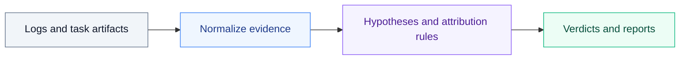

<div align="center">

# Case Failure Analyzer

**Evidence-based failure audits for scientific-computing benchmarks**

[](pyproject.toml)
[](pyproject.toml)
[](SKILL.md)

[简体中文](README.zh.md) · [Skill definition](SKILL.md) · [User guide](docs/en/guide.md)

[Quick start](#quick-start) · [Attribution](#how-attribution-works) · [Reports](#report-files) · [Development](#repository-and-development) · [Docs](#documentation)

</div>

---

Case Failure Analyzer (CFA) audits scientific-computing benchmark trials after execution. It reads available job and trial logs, agent trajectories, task definitions, verifier results and code, and collected deliverables. It produces an evidence-linked verdict, a Markdown report, and machine-readable findings.

> **Requirements** · Python 3.9+ · Standard library only at runtime
>
> The audit reads existing artifacts and writes to a separate report directory. Simulations and verifier code are examined statically.

Core outputs from task-ID mode

| Cause verdict | Traceable evidence | Batch overview |
| :--- | :--- | :--- |
| Compare four causes and explain the primary finding | Locate failed checks, logs and execution steps | Review scoring states, pass rates and task reports |
| `summary.md` | `data/evidence.json` | `INDEX.md` |

---

## Quick start

From the CFA repository, set `BENCH_ROOT` to the benchmark checkout containing the jobs and task definitions.

### 1. Audit a task

```bash
BENCH_ROOT="/path/to/benchmark"
python3 scripts/cfa.py audit task208 --jobs-root "$BENCH_ROOT" --lang en
```

### 2. Inspect failed checks

```bash
python3 scripts/cfa.py inspect task208 --jobs-root "$BENCH_ROOT" --section errors
```

### 3. Audit all tasks

```bash
python3 scripts/cfa.py audit --all --jobs-root "$BENCH_ROOT" --lang en
```

<details>
<summary><strong>Task selection, verdicts and inspection options</strong></summary>

- **One task.** A reference such as `task208` selects the newest matching trial by modification time. Quote a full name such as `"task 208__jaekojA"` to select a specific trial. Without an explicit root, the analyzer uses `CFA_JOBS_ROOT` if set, or checks the current directory and its parent.
- **Read the verdict.** The single-task command prints the verdict card followed by `REPORT_DIR:`. The card starts with the verdict and main cause, compares the four categories, then gives the selected subtype, evidence and named failed checks when available. When used as a skill, return the card in the conversation and link the report.
- **Audit all tasks.** `audit --all` discovers task IDs, processes them in natural order and rebuilds the global index. Add `--verdict-stdout` to print every card.
- **Inspect saved results.** `inspect` supports `verdict`, `report`, `errors`, `confidence`, `evidence`, `anchors` and `data`. It masks home-directory paths and recognized credential patterns by default. `--raw` selects raw JSON or section text where available.

The report root depends on the benchmark layout. To rebuild the index, pass the actual `failure-report/` directory to `python3 scripts/cfa.py index --report-root /path/to/failure-report`.

</details>

<details>
<summary><strong>Audit by directory · Runnable regression example</strong></summary>

### Audit a known job or trial directory

Use `scripts/analyze_case.py --job … --output …` when you already have a path. Keep the output separate from the input directories. Add `--task` to supply a task definition or `--trial` to select one trial within a job.

This example runs against a regression fixture in the repository.

```bash
REPORT_DIR="$(mktemp -d)"
python3 scripts/analyze_case.py \
  --job tests/fixtures/regressions/mixed-job-success-trial/job \
  --output "$REPORT_DIR" \
  --lang en
cat "$REPORT_DIR/job_summary.md"
```

The fixture has **one scored pass, zero scored failures, and one unscored trial**. The report shows a **50.0% overall pass rate** and a **100.0% scored pass rate**. The unscored trial receives `UNKNOWN_INSUFFICIENT_EVIDENCE`.

</details>

---

## How attribution works



CFA normalizes runtime state, trajectory events, task contracts, verifier checks and scientific error signatures into evidence. It records candidate hypotheses and evaluates a fixed sequence of rules. The first applicable rule produces a structured `failure-analysis-v1` verdict and a decision trace. Evidence references connect the verdict to observations and, where available, source files or execution steps.

| Peer category | What the audit examines |
| --- | --- |
| `agent` · Agent decisions and execution | Method, parameters, workflow, task contract compliance and validation of delivered results |
| `verifier` · Verifier rules and scoring | Parser or comparison defects, tolerance rules and internal recomputation failures |
| `case` · Benchmark and task design | Missing assets, ambiguous requirements and inconsistent references |
| `infra` · Runtime and infrastructure | Startup, container, network and runner failures, including artifact collection |

The engine checks passed trials first, then startup and runner boundaries, case defects, verifier defects, numerical divergence, insufficient evidence and agent execution. `unknown` records insufficient evidence. Agent attribution requires a specific observed deviation. Numerical divergence requires corroboration across the task requirements, verifier rules and runtime evidence. The confidence breakdown shows which evidence factors contributed to the score.

### Harbor-specific handling

- The declared deliverables come from `task.toml` and are checked against the collected artifact tree.
- A runner failure after the agent starts and before the verifier runs can produce an unscored trial. When the artifact-collection rule applies, the verdict records infrastructure as the primary cause and can retain a missing deliverable as a contributing factor.
- Supported verifier JSON layouts are normalized into named checks and a diagnosability assessment. Batch summaries distinguish scored passes, scored failures and unscored trials.

### Scientific software coverage

The error registry contains 60 implemented signature families across 11 software and workflow groups, including CP2K, Quantum ESPRESSO, LAMMPS, ASE and ML interatomic potentials. These patterns identify observations in existing logs and artifacts. [Error registry](references/error-families.json) · [Software notes](references/software/)

---

## Report files

The layout below assumes a full run with the default `--format both`. Use `--lang zh`, `en` or `bilingual` (default) for report language, or `--phase collect` for evidence and hypotheses only.

| Entry point | Default output |
| --- | --- |
| Task ID · `cfa.py audit task208` | `failure-report/task208/task208.md` and `summary.md`, with evidence, hypotheses, attribution and card metadata under `data/`. The global `failure-report/INDEX.md` summarizes scoring and attribution across audited tasks. |
| Single trial by path · `analyze_case.py --job … --output …` | `report.md` and language editions, plus `evidence.json`, `candidate-hypotheses.json` and `analysis.json` directly under the output directory. |
| Multi-trial job by path | `job_summary.md` and `job_summary.json` at the output root, with per-trial reports and JSON under each trial name. |

Typical task-ID layout (`--lang en --format both`)

```text
failure-report/
├── INDEX.md
└── task208/
    ├── task208.md
    ├── summary.md
    ├── skill-prescription.md    # when applicable
    └── data/
        ├── evidence.json
        ├── candidate-hypotheses.json
        ├── analysis.json
        └── summary.json
```

`--report-dir` overrides the task-ID report directory. `skill-prescription.md` is generated only when the primary cause is `agent` and the audit identifies a reusable capability gap. If you refine `analysis.json`, check it against the evidence with `scripts/validate_analysis.py` and regenerate the report with `scripts/render_report.py`.

---

## Repository and development

| Path | Role |
| --- | --- |
| [`SKILL.md`](SKILL.md) · [`agents/openai.yaml`](agents/openai.yaml) | Skill instructions and interface metadata |
| [`scripts/`](scripts/) · [`scripts/attribution/`](scripts/attribution/) | CLI, evidence collection, attribution, validation and rendering |
| [`references/`](references/) · [`docs/`](docs/) | Skill references and English/Chinese documentation |
| [`tests/`](tests/) | CLI, attribution, report and regression fixtures |

```bash
make test
make check-docs
make smoke
make export-skill DEST=/path/to/skills/case-failure-analyzer
```

`make test` uses `unittest`. `make check` also runs Ruff checks and requires the development tooling. `make export-skill` packages the skill instructions, interface metadata, scripts and references. Its default destination is `$CODEX_HOME/skills/case-failure-analyzer`, with `~/.codex` as the default Codex home.

---

## Documentation

| Topic | English | 简体中文 |
| --- | --- | --- |
| Workflow and usage | [Guide](docs/en/guide.md) | [使用指南](docs/zh/guide.md) |
| Cause categories | [Taxonomy](docs/en/taxonomy.md) | [根因分类](docs/zh/taxonomy.md) |
| Rule order and evidence requirements | [Attribution protocol](docs/en/attribution-protocol.md) | [归因协议](docs/zh/attribution-protocol.md) |
| Machine-readable fields | [Evidence schema](docs/en/evidence-schema.md) | [证据结构](docs/zh/evidence-schema.md) |
| Markdown outputs | [Report schema](docs/en/report-schema.md) | [报告规范](docs/zh/report-schema.md) |
| Reusable agent capability gaps | [Skill prescription policy](docs/en/skill-prescription-policy.md) | [技能处方策略](docs/zh/skill-prescription-policy.md) |
