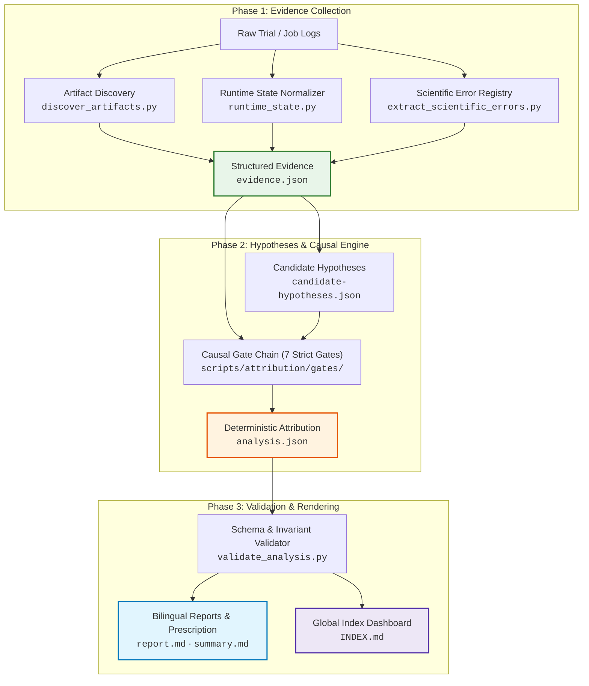

<div align="center">

# 🔬 Case Failure Analyzer (CFA)

**Evidence-first causal failure analysis & diagnostic toolkit for scientific-computing and MLIP agent benchmarks.**

[](pyproject.toml)
[-2ea44f?style=flat-square)](scripts/)
[](tests/)
[](scripts/attribution/)
[](LICENSE)

<br/>

[📖 English](README.md) &nbsp;•&nbsp; [🇨🇳 简体中文](README.zh.md) &nbsp;•&nbsp; [⚡ Quick Start](#-quick-start) &nbsp;•&nbsp; [🏗️ Architecture](#️-architecture--engine) &nbsp;•&nbsp; [📚 Docs Index](#-documentation-index)

</div>

---

## 🌟 Highlights: Understand Failures at a Single Glance

CFA replaces uninformative "agent failed" labels with deterministic, verifiable causal receipts.

```
┌────────────────────────────────────────────────────────────────────────────────────────┐
│  1. Error Matrix       │ Failed checks, exact deltas, tolerances & over-bound ratios   │
│  2. Resolved Evidence  │ Internal IDs (sci:1, ver:fail_log) resolved into file/lines   │
│  3. Confidence Receipt │ Transparent score scale (e.g. 9/10), signed factors & gaps    │
│  4. Four Peer Verdicts │ Strict attribution across agent · verifier · case · infra     │
│  5. Global Index Board │ Automatic INDEX.md board with normalized non-passed shares    │
└────────────────────────────────────────────────────────────────────────────────────────┘
```

| Core Pillar | What Reviewers See |
|:---|:---|
| 📊 **At-a-Glance Error Matrix** | Tabular overview with check name, error nature, delivered vs expected values, margin ratio (e.g. `15986.7× over bound`), and authoritative source. |
| 🔍 **Human-Readable Evidence** | Opaque trace markers (`sci:recompute_divergence:1`, `art:...`) are mapped to concrete execution steps and deliverable file pointers. |
| 🎯 **Transparent Confidence** | Heuristic score receipt (e.g. `9/10 pts`), displaying positive/negative evidence factors and explicit hints on what is missing to raise confidence. |
| ⚖️ **Four Peer Categories** | Evaluates `agent`, `verifier`, `case`, and `infra` on equal footing—ruling out external causes with evidence before attributing fault to the agent. |
| 📈 **Automated Global Board** | `INDEX.md` dashboard with three-state stats, pass rates, naturally-sorted task manifests, and normalized category distributions. |

---

## 🧪 Supported Scientific Computing Ecosystem

Built-in support with 60+ curated domain error families and adapters across 11 scientific suites:

| Domain | Supported Engines & Frameworks |
|:---|:---|
| **DFT & Plane-Wave** | `CP2K` · `Quantum ESPRESSO` · `VASP` · `ABACUS` |
| **Quantum Chemistry** | `ORCA` · `Gaussian` · `PySCF` · `xTB` |
| **Molecular Dynamics** | `LAMMPS` · `GROMACS` · `AMBER` · `OpenMM` |
| **Machine Learning Potentials** | `MACE` · `NequIP` · `DeePMD-kit` · `CHGNet` · `SevenNet` |
| **Cheminformatics & Numerics** | `ASE` · `RDKit` · `SciPy` · `NumPy` · `JAX` · `PyTorch` · `FEniCS` · `OpenFOAM` |

---

## ⚡ Quick Start

### Unified CLI (`cfa.py`)

```bash
# 1. Audit a single benchmark task by ID (resolves newest trial & prints verdict card)
python3 scripts/cfa.py audit task208 --jobs-root <benchmark checkout> --lang zh

# 2. Batch audit all tasks discovered under a benchmark directory
python3 scripts/cfa.py audit --all --jobs-root <benchmark checkout>

# 3. Read-only inspection with automatic path & credential redaction
python3 scripts/cfa.py inspect task208 --section errors        # Error Matrix & failed checks
python3 scripts/cfa.py inspect task208 --section confidence    # Confidence receipt & score scale
python3 scripts/cfa.py inspect task208 --section evidence      # Human-grounded evidence digest
python3 scripts/cfa.py inspect task208 --section verdict       # Summary card (summary.md)

# 4. Atomically rebuild the global board (INDEX.md)
python3 scripts/cfa.py index --report-root <benchmark checkout>/failure-report
```

> Reports automatically land in `<benchmark>/failure-report/<task_id>/` accompanied by an atomically updated global dashboard at `<benchmark>/failure-report/INDEX.md`.

---

## 🖥️ Live Output Preview

When auditing a failure (e.g. `task208`), CFA delivers an instant, self-contained terminal verdict card:

```markdown
# task208 — 根因速览 (Root Cause Verdict)

**裁定**: `failed` · **主根因**: 智能体决策与执行失误 (`agent`) / `result_validation` / `AGENT_RESULT_VALIDATION`（置信度 **0.90**）
**可信度拆解**: 🟢 `9/10 分` · ✓ 直接因果实证 (2项)(+2) · ✓ 跨源证据互证(+1) · ✓ 唯一阻断项反事实闭环(+2) · ✓ 偏差超容差 1.599e+04×(+2) · ✓ 单项检查精准定位(+1) · ✓ 竞争假设区分度高(+1)

**失败原因 (Why it failed)**: [L3] neutral_stationary: R02-M01/site000003 charge differs from independent frozen EQeq replay by 1.59869e-06 e beyond its decimal serialization bound 1.00001e-10 e

## 1. 四大类裁决 (Four Peer Categories)
| 大类 | 裁决 | 依据 |
|---|---|---|
| `agent` 智能体决策与执行失误 | **主因** | Agent 交付的 'charge' = 0.898982845013923 与验证器独立复算相差 1.59869e-06，超出容差上限 1.00001e-10。 |
| `verifier` 评测验证与规则判定缺陷 | **已排除** | 失败检查明确指出指标容差，并在产物中定位到实测值；属于交付数值错误而非复算缺陷。 |
| `case` 基准题目与规格设计缺陷 | **未选为主因** | 契约审计未发现题目资产缺失或规格歧义。 |
| `infra` 运行环境与系统设施缺陷 | **未选为主因** | 未检出因果性 infra 观测；容器与验证器均正常运行完毕。 |

## 2. 具名失败检查与错误矩阵 (Error Matrix)
| 检查项 | 错误性质 | 交付值 vs 复算/期望值 | 偏差 / 容差 (超标倍数) | 说明与来源 |
|---|---|---|---|---|
| `[L3] neutral_stationary` | 数值偏差 | `0.898982845013923` vs `独立复算重放` | Δ = 1.59869e-06 / tol 1.00001e-10 (15986.7× 超标) | R02-M01/site000003 charge differs from frozen EQeq replay (来源: `raw-verifier.json`) |
```

---

## 🏗️ Architecture & Engine

### Pipeline Flow



### 7-Gate Attribution Chain

Evaluated sequentially by `scripts/attribution/engine.py`. The first matching gate wins:

```text
Gate 0: Passed Trial        ──▶ Trial succeeded; emits clean lightweight report
  ↓ (failed)
Gate 1: Infra & Unknown     ──▶ Pre-startup container failures / unrecorded terminations
  ↓ (agent started)
Gate 2: Case Defect         ──▶ Missing assets, broken task specification, ambiguous contracts
  ↓ (case clean)
Gate 3: Verifier Defect     ──▶ Verifier script crashes, parser hazards, ultra-tight tolerances
  ↓ (verifier valid)
Gate 4: Numerical Divergence──▶ Direct recompute discrepancy, over-bound delta, parameter trade-off
  ↓ (no numerical match)
Gate 5: Insufficient Evid.  ──▶ Ambiguous signals; refuses blind blame on agent
  ↓ (positive agent evidence)
Gate 6: Primary Agent Fault ──▶ Schema mismatch, self-check coverage gap, unverified outputs
```

---

## 💻 CLI Reference & Details

<details>
<summary><b>🔍 Click to view <code>cfa.py</code> Subcommands & Inspection Flags</b></summary>

### `cfa.py` Command Matrix

| Subcommand | Purpose | Key Arguments |
|:---|:---|:---|
| `audit` | Resolves trial, executes full pipeline, and outputs verdict card. | `<task_id>`, `--all`, `--jobs-root <dir>`, `--lang zh\|en\|bilingual` |
| `inspect` | Read-only inspection of processed tasks with sensitive data redaction. | `<task_id>`, `--section verdict\|errors\|confidence\|evidence`, `--raw` |
| `index` | Atomically locks and rebuilds the global `INDEX.md` board. | `--report-root <dir>` |

### `cfa inspect` Section Breakdown

- `--section verdict`: Prints the compact verdict card (`summary.md`).
- `--section errors`: Error Matrix detailing layer, failure kind, delivered value, recomputed delta, and over-bound multiplier.
- `--section confidence`: Transparent point receipt (`points / denominator`), active positive/negative factors, and gap hints.
- `--section evidence`: Concise digest of runtime state, check counts, causal anchors, and behavioral signals without dumping 200KB+ JSON.
- `--raw`: Emits unformatted JSON data for pipeline scripting.

</details>

<details>
<summary><b>🛠️ Click to view Low-level Path Mode (<code>analyze_case.py</code>) & Model-in-the-Loop</b></summary>

### Manual Invocation

```bash
python3 scripts/analyze_case.py \
  --job jobs/<job_name> \
  --task tasks/<task_name> \
  --output <output-dir>/<case_id> \
  --lang bilingual
```

| Parameter | Type | Description |
|:---|:---|:---|
| `--job` | Path | Job directory or specific trial directory **(Required)**. |
| `--output` | Path | Destination folder; strictly isolated from inputs **(Required)**. |
| `--task` | Path | Benchmark task specification folder (auto-discovered if omitted). |
| `--trial` | String | Specific trial name or `all` (default: `all`). |
| `--lang` | Choice | `bilingual` (default), `zh` (Chinese standalone), or `en` (English standalone). |
| `--format` | Choice | `both` (default), `json`, or `markdown`. |
| `--phase` | Choice | `all` (full pipeline) or `collect` (evidence & hypotheses only). |

### Output Files Structure

Inside `<output-dir>/<case_id>/`:
- `summary.md`: Clean verdict card identical to stdout.
- `report.md`: Core 4-section causal audit report (`< 30` lines for passed trials).
- `skill-prescription.md`: Domain capability repair prescription (generated only for reusable agent flaws).
- `data/evidence.json`: Normalized timeline, runtime state, and scientific error observations.
- `data/analysis.json`: Machine-readable causal attribution result (`failure-analysis-v1`).
- `data/summary.json`: Structured verdict metadata.

### Model-in-the-Loop Validation

To submit and validate a LLM-authored attribution before final publication:

```bash
# 1. Validate attribution invariants against evidence
python3 scripts/validate_analysis.py \
  --evidence <output-dir>/<case_id>/evidence.json \
  --analysis <output-dir>/<case_id>/analysis.json \
  --report   <output-dir>/<case_id>/report.md

# 2. Render final reports
python3 scripts/render_report.py \
  --evidence <output-dir>/<case_id>/evidence.json \
  --analysis <output-dir>/<case_id>/analysis.json \
  --output-report <output-dir>/<case_id>/report.md \
  --lang bilingual
```

</details>

---

## 📁 Repository Layout

```text
case-failure-analyzer/
├── SKILL.md                 # Agent-facing skill entrypoint & system prompt contract
├── README.md / README.zh.md # Project documentation (bilingual English | 简体中文)
├── Makefile                 # Engineering entrypoints: test, lint, format, check-docs, export-skill
├── pyproject.toml           # Package metadata (zero runtime dependencies, py39+)
├── docs/{en,zh}/            # Human-readable mirrors of references/
├── references/              # Single source of truth for agent-consumed domain knowledge
│   ├── taxonomy.md          # Failure taxonomy hierarchy
│   ├── attribution-protocol.md # Step-by-step causal attribution protocol
│   ├── error-families.json  # 60+ scientific error patterns across 11 suites
│   └── software/*.md        # Per-software knowledge bases (CP2K, VASP, LAMMPS, etc.)
├── scripts/                 # Portable, stdlib-only Python modules
│   ├── cfa.py               # Unified CLI (audit, inspect, index)
│   ├── analyze_case.py      # Core pipeline entrypoint
│   ├── staging.py           # Atomic staging, file locking & transactional publishing
│   ├── render_report.py     # Markdown report & prescription renderer
│   ├── report_style.py      # Single source of truth for bilingual terminology & tables
│   └── attribution/         # 7-gate causal decision engine
└── tests/                   # 384 test cases (unit, decision table, baseline characterization)
```

---

## 🔧 Development & Testing

The runtime is strictly standard-library only. Testing tools require no complex environment setup:

```bash
make test          # Run full unittest suite (384 tests, 0 dependencies)
make check         # Full quality gate: lint, unittest, doc sync & format check
make smoke         # End-to-end CLI validation on regression fixtures
make export-skill  # Export clean skill tree excluding tests & development files
```

### Exporting Production Skill

```bash
# Export to default destination ($CODEX_HOME/skills/case-failure-analyzer)
make export-skill

# Export to custom directory
make export-skill DEST=/path/to/target/case-failure-analyzer
```

---

## 📚 Documentation Index

| Document | English | 简体中文 |
|:---|:---:|:---:|
| **Project Overview & CLI** | [README.md](README.md) | [README.zh.md](README.zh.md) |
| **System Guide & Workflow** | [guide.md](docs/en/guide.md) | [guide.md](docs/zh/guide.md) |
| **Failure Taxonomy (`failure-analysis-v1`)** | [taxonomy.md](docs/en/taxonomy.md) | [taxonomy.md](docs/zh/taxonomy.md) |
| **Causal Attribution Protocol** | [attribution-protocol.md](docs/en/attribution-protocol.md) | [attribution-protocol.md](docs/zh/attribution-protocol.md) |
| **Evidence & Analysis JSON Schemas** | [evidence-schema.md](docs/en/evidence-schema.md) | [evidence-schema.md](docs/zh/evidence-schema.md) |
| **Report Structure Specification** | [report-schema.md](docs/en/report-schema.md) | [report-schema.md](docs/zh/report-schema.md) |
| **Skill Prescription Policy** | [skill-prescription-policy.md](docs/en/skill-prescription-policy.md) | [skill-prescription-policy.md](docs/zh/skill-prescription-policy.md) |

---

<div align="center">

Made with 🔬 for rigorous, evidence-grounded AI scientific computing evaluation.

</div>
