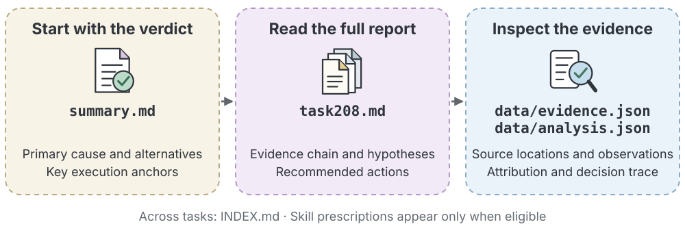

# Case Failure Analyzer

English · [简体中文](README.zh.md)

Case Failure Analyzer (CFA) reads the records of a scientific benchmark trial to find where it stopped or which check rejected the submission. If the records support a cause, CFA attributes it to an agent decision, the verifier, the task design, or the runtime environment. A report can identify the exact rejected field while leaving responsibility open.

For an agent failure, a reviewer can trace the decision to one of eight capabilities, such as physical modelling, post-processing, or independent validation. [Agent capability dimensions](docs/en/taxonomy.md#agent-capability-dimensions)


Requires Python 3.9+ with no third-party runtime dependencies. Reviews saved artifacts and benchmark verification records without rerunning calculations. Reports support Chinese, English, or both.

## Usage

From this repository root, export to your client’s skill directory ([installation locations](docs/en/guide.md#installation-and-invocation)):

```bash
python3 scripts/export_skill.py --dest /path/to/skills/case-failure-analyzer
```

Invoke it in an agent chat. Clients without skill discovery can read `SKILL.md` from the exported directory:

```text
Use case-failure-analyzer to analyze task208 in /path/to/benchmark.
Audit missing deliverables and existing verifier records, then explain the
candidate cause and evidence gaps in English.
```

Or run the CLI directly in a terminal:

```bash
python3 scripts/cfa.py audit task208 --jobs-root /path/to/benchmark --lang en
```

Use `--lang bilingual` for a separate English edition: `<task_id>.en.md` in task-ID mode or `report.en.md` in path mode. The unsuffixed Markdown file is the primary report, not necessarily the English edition.

Replace the example path with a benchmark checkout containing `jobs/` and `tasks/`. A task number selects the most recently modified matching trial. See the [guide](docs/en/guide.md) for specific trials, batch audits, inspection, comparisons, and updates.

## Output

A task-ID audit writes its reports to `<benchmark>/failure-report/<job>/<task_id>/` and prints a verdict card. Read the card for the candidate cause. Use `inspect --section errors` to see the recorded interruption or rejection, its source and, when available, the matching scorer condition and submitted value.



In two CompChemWorld batches, CFA located a recorded interruption or scoring rejection in all 126 failed or errored trials. Its rules identified a candidate cause in 95 of them. [Validation results and worked examples](docs/en/compchemworld-validation.md)

## Documentation

[Installation and invocation](docs/en/guide.md#installation-and-invocation) · [Taxonomy](docs/en/taxonomy.md) · [Attribution rules](docs/en/attribution-protocol.md)

[Evidence fields](docs/en/evidence-schema.md) · [Report format](docs/en/report-schema.md) · [Skill prescriptions](docs/en/skill-prescription-policy.md) · [Evidence review](docs/en/evidence-review.md) · [Skill definition](SKILL.md)

[Script map](scripts/README.md) · [Portable reference index](references/README.md)
