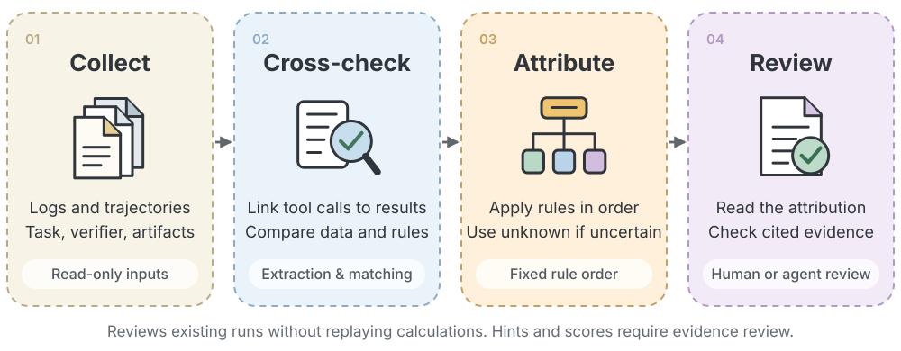

# Case Failure Analyzer

English · [简体中文](README.zh.md)

CFA is a portable skill for analyzing failed scientific-computing benchmarks across agent clients. It reads logs, agent trajectories, task instructions, verifier code, and deliverables, then attributes failures to agent decisions, verifier rules, task design, or infrastructure. Reports cite the evidence; insufficient evidence yields an unknown result.



Requires Python 3.9+ with no third-party runtime dependencies. Reviews saved artifacts and benchmark verification records without rerunning calculations. Reports support Chinese, English, or both.

## Usage

From this repository root, export to your client’s skill directory ([installation locations](docs/en/guide.md#installation-and-invocation)):

```bash
python3 scripts/export_skill.py --dest /path/to/skills/case-failure-analyzer
```

Invoke it in an agent chat. Clients without skill discovery can read `SKILL.md` from the exported directory:

```text
Use case-failure-analyzer to analyze task208 in /path/to/benchmark.
Audit missing deliverables and existing verifier records, then explain the
candidate cause and evidence gaps in English.
```

Or run the CLI directly in a terminal:

```bash
python3 scripts/cfa.py audit task208 --jobs-root /path/to/benchmark --lang en
```

Use `--lang bilingual` for a separate English edition: `<task_id>.en.md` in task-ID mode or `report.en.md` in path mode. The unsuffixed Markdown file is the primary report, not necessarily the English edition.

Replace the example path with a benchmark checkout containing `jobs/` and `tasks/`. A task number selects the most recently modified matching trial. See the [guide](docs/en/guide.md) for specific trials, batch audits, inspection, comparisons, and updates.

## Output

Task-ID mode writes to `<benchmark>/failure-report/<job>/<task_id>/` and returns an attribution summary in the terminal or chat. Follow this path to review the results:


## Documentation

[Installation and invocation](docs/en/guide.md#installation-and-invocation) · [Taxonomy](docs/en/taxonomy.md) · [Attribution rules](docs/en/attribution-protocol.md)

[Evidence fields](docs/en/evidence-schema.md) · [Report format](docs/en/report-schema.md) · [Skill prescriptions](docs/en/skill-prescription-policy.md) · [Evidence review](docs/en/evidence-review.md) · [Skill definition](SKILL.md)
