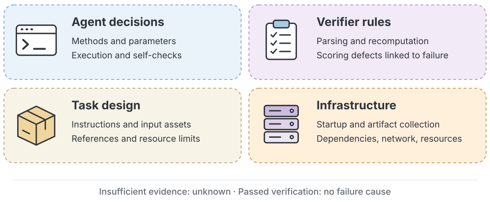

# Case Failure Analyzer

English · [简体中文](README.zh.md) · [Skill definition](SKILL.md) · [Guide](docs/en/guide.md)

CFA reviews failed scientific-computing benchmark trials after execution. It reads runtime logs, agent trajectories, task instructions, verifier code, and collected deliverables, then produces a rule-based attribution report with evidence references for human or agent review.


Root causes fall into four categories: agent decisions and execution (`agent`), verifier rules (`verifier`), task design (`case`), and runtime infrastructure (`infra`). Insufficient evidence yields `unknown`; passed trials use `none`. Reports are available in Chinese, English, or both.

Requires Python 3.9+ with no third-party runtime dependencies. The analysis does not rerun scientific calculations. Inputs remain read-only and reports go to a separate directory. Attribution and confidence use rules and heuristic scores; a score is not a probability that the cause is correct.

[Quick start](#quick-start) · [Inspect results](#inspect-and-compare-results) · [Attribution](#analysis-and-limitations) · [Documentation](#documentation)

## Quick start

Run these commands from the repository root. Set `BENCH_ROOT` to a benchmark checkout containing `jobs/` and `tasks/`:

```bash
BENCH_ROOT="/path/to/benchmark"
python3 scripts/cfa.py audit task208 --jobs-root "$BENCH_ROOT" --lang en
```

By default, the command selects the most recently modified trial for that task, prints an attribution summary, and writes reports to `<bench_root>/failure-report/task208/`. Pass a full trial name, such as `"task 208__jaekojA"`, to select a specific trial, or `--report-dir` to change the output location. Without `--jobs-root`, resolution checks `$CFA_JOBS_ROOT`, the current directory, and its parent.

<details>
<summary>No job data yet? Try the built-in fixture</summary>

To try CFA without your own job data, run the committed regression fixture:

```bash
REPORT_DIR="$(mktemp -d)"
python3 scripts/analyze_case.py \
  --job tests/fixtures/regressions/mixed-job-success-trial/job \
  --output "$REPORT_DIR" \
  --lang en
cat "$REPORT_DIR/job_summary.md"
```

The fixture produces 1 scored pass, 0 scored failures, and 1 unscored trial. Its overall pass rate is 50.0% and its scored pass rate is 100.0%; the unscored trial receives `UNKNOWN_INSUFFICIENT_EVIDENCE`. These figures describe the fixture's trial outcomes, not attribution accuracy.

</details>

## Inspect and compare results

`inspect` and `diff` read existing reports. Audit both tasks before comparing them:

```bash
python3 scripts/cfa.py inspect task208 --jobs-root "$BENCH_ROOT" --section errors
python3 scripts/cfa.py inspect task208 --jobs-root "$BENCH_ROOT" --section artifacts
python3 scripts/cfa.py inspect task208 --jobs-root "$BENCH_ROOT" --section step --step 43

python3 scripts/cfa.py audit task207 --jobs-root "$BENCH_ROOT" --lang en
python3 scripts/cfa.py diff task207 task208 --jobs-root "$BENCH_ROOT"

# Audit all tasks and update failure-report/INDEX.md
python3 scripts/cfa.py audit --all --jobs-root "$BENCH_ROOT" --lang en
```

Other `inspect --section` values are `verdict`, `report`, `confidence`, `evidence`, `anchors`, and `data`. The `step` section shows an index of the latest 5 steps when `--step` is omitted. Both `inspect` and `diff` mask home-directory paths and some common credential patterns by default. `--raw` changes only the output format; `--no-redact` disables masking. These rules do not guarantee removal of all sensitive content.

Use `diff task208 --trials <t1> <t2>` to compare existing trial archives under `trials/`. Omitting `--trials` selects the two most recently modified archived reports, not the two latest job start times. Evidence omitted from lightweight archives is not recovered automatically; use `--archive-evidence` when auditing if you need full evidence later.

### Report layout

Typical task-ID output with `--lang en --format both`:

```text
failure-report/
├── INDEX.md                      # Scored passes, scored failures, and unscored trials
└── task208/
    ├── task208.md                # Full report with evidence references
    ├── summary.md                # Attribution summary printed to the terminal
    ├── skill-prescription.md     # Only for an agent cause with a reusable capability gap
    ├── trials/                   # Archives when earlier trials are available
    └── data/
        ├── evidence.json
        ├── candidate-hypotheses.json
        ├── analysis.json         # Includes decision_trace
        └── summary.json
```

Path mode (`analyze_case.py --job ... --output ...`) writes files such as `report.md` and `analysis.json`. Multi-trial jobs also receive `job_summary.md` and `job_summary.json`. See the [guide](docs/en/guide.md) for languages, output formats, and layouts.

To rebuild the index separately, run `python3 scripts/cfa.py index --report-root <failure-report-directory>`. After manually editing `analysis.json`, check it with `scripts/validate_analysis.py` and regenerate the report with `scripts/render_report.py`.

## Analysis and limitations



CFA links trajectory tool calls to their results, then compares them with deliverables, task requirements, and verifier checks. It supports ATIF JSON and recognized OpenAI/Anthropic JSON or JSONL message structures; a matching file extension does not imply support for every trajectory schema. When long observations are truncated, it attempts to retain diagnostic and metric lines from the middle.

Numerical comparisons and causal anchors provide the following leads, subject to review:

- Named-metric pairing no longer rejects a match solely because its numerical deviation is large, but still depends on field-name matching. Unnamed metrics retain numerical-proximity thresholds.
- `scale_or_sign_hint` suggests common unit factors, powers of ten, or a sign flip from numerical ratios. It does not read physical-unit metadata or independently establish a unit error.
- `stale_deliverable_sync` means execution-related text contains a number close to the recomputed value. It can fire without a collected deliverable; check the files, outputs, and execution order before concluding that a result was left unsaved.
- Script output paths and `parameter_evolution` are extracted statically. Parameter changes compare the first and last values by name and may span files. Anchor scores rank candidates; they do not establish causation on their own.
- `deliverable_diagnostics` checks JSON/CSV/TSV for empty data and non-finite values within scan limits. Missing-key checks apply only to discovered `results.json` files, so this is not complete deliverable validation.

See the [evidence schema](docs/en/evidence-schema.md) for fields, thresholds, and scan limits.

### Attribution order

The engine evaluates Gate 0–6 in a fixed priority order, returns the first matching result, and records `decision_trace`. This rule order is not a proven causal timeline for every trial.

| Gate | Check | Possible outcome |
| :--- | :--- | :--- |
| 0 | Verification passed or reward reached the pass threshold | `none` |
| 1a / 1b | Infrastructure errors or missing evidence before agent startup | `infra` / `unknown` |
| 1c | Runner or artifact-collection faults after agent execution and before verification | `infra` |
| 2 | Task asset or definition defects | `case` |
| 3 | Verifier crashes or parser defects directly linked to failure | `verifier` |
| 4 | Corroborated recompute divergence, or overly strict instantaneous tolerance despite matching ensemble statistics | `agent` / `verifier` |
| 5 | No positive evidence of agent deviation | `unknown` |
| 6 | Classify agent causes from behavioral, contract, and scientific-error evidence | `agent` |

`reward == 0` alone does not justify agent attribution, and an agent that never started cannot be blamed. Trials whose verifier did not run are counted separately as unscored. A verifier delta is not a delivered value, and numbers in an agent's final answer cannot substitute for execution evidence. Full conditions and exceptions are in the [attribution protocol](docs/en/attribution-protocol.md) and [skill definition](SKILL.md).

## Software rules and development

The [error registry](references/error-families.json) contains 11 software groups and 60 error families spanning quantum chemistry, molecular dynamics, machine-learning interatomic potentials, and general numerical computing. Coverage means log-matching rules and evidence guides, not validation of every software version or failure mode. See the [software list](docs/en/guide.md#scientific-software-error-signatures).

`SKILL.md` and `agents/` define the skill entrypoint; `scripts/` contains analysis and reporting code; `references/` holds protocols and field definitions; `docs/` provides English and Chinese documentation; and `tests/` contains unit tests and regression fixtures.

```bash
make compile       # Python syntax checks
make test          # Standard-library unittest suite
make check-docs    # English mirrors and guide language links
make smoke         # Committed two-trial fixture
make check         # Lint, tests, docs, and formatting (requires ruff)
make export-skill DEST=/path/to/skills/case-failure-analyzer
```

## Documentation

| Topic | English | 简体中文 |
| :--- | :--- | :--- |
| Workflow and usage | [Guide](docs/en/guide.md) | [使用指南](docs/zh/guide.md) |
| Cause categories | [Taxonomy](docs/en/taxonomy.md) | [根因分类](docs/zh/taxonomy.md) |
| Rule order and evidence requirements | [Attribution protocol](docs/en/attribution-protocol.md) | [归因协议](docs/zh/attribution-protocol.md) |
| Machine-readable fields | [Evidence schema](docs/en/evidence-schema.md) | [证据结构](docs/zh/evidence-schema.md) |
| Markdown outputs | [Report schema](docs/en/report-schema.md) | [报告规范](docs/zh/report-schema.md) |
| Reusable agent capability gaps | [Skill prescription policy](docs/en/skill-prescription-policy.md) | [技能处方策略](docs/zh/skill-prescription-policy.md) |
