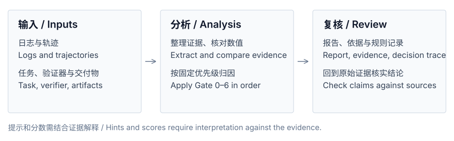
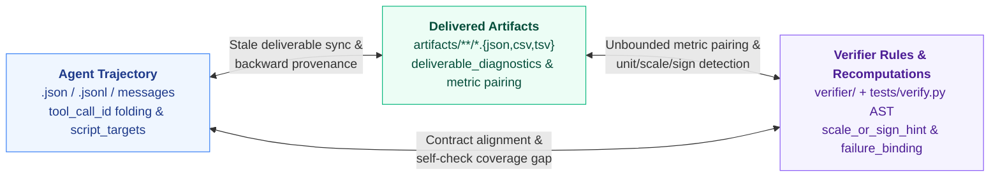
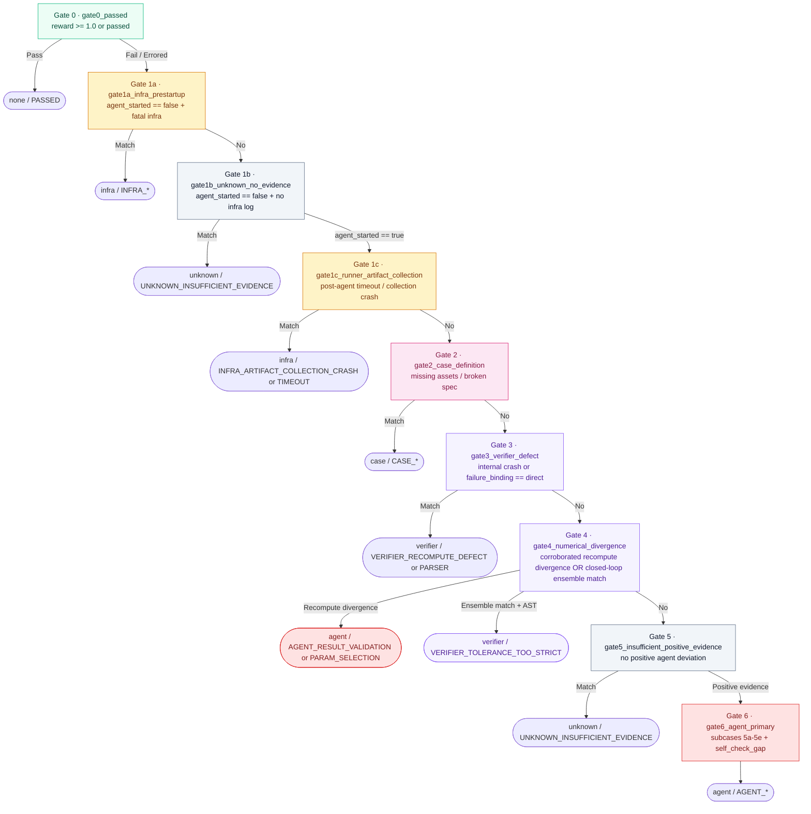

<div align="center">

# Case Failure Analyzer

**Evidence-based, closed-loop causal failure audits for scientific-computing benchmarks**

[](pyproject.toml)
[](pyproject.toml)
[](docs/en/taxonomy.md)
[](references/error-families.json)
[](docs/en/evidence-schema.md)
[](SKILL.md)

[简体中文](README.zh.md) · [Skill definition](SKILL.md) · [User guide](docs/en/guide.md)

[Cross-Check](#three-way-closed-loop-cross-check) · [Quick Start](#quick-start) · [Attribution Funnel](#gate-06-short-circuit-attribution-funnel) · [CLI & Reports](#cli-cheat-sheet--report-layout) · [Software Coverage](#scientific-software-coverage-11-suites--60-families) · [Docs](#documentation)

</div>

<p align="center"></p>

---

Case Failure Analyzer (CFA) audits scientific-computing benchmark trials strictly post-hoc and read-only. It inspects runner logs, multi-format agent trajectories, task contracts, verifier code and structured reports, and collected deliverables to produce a deterministic verdict card, bilingual audit report, and machine-readable evidence graph.

> **Runtime & Safety** · Python 3.9+ · Zero external runtime dependencies (pure stdlib) · Input directories (`jobs/`, `tasks/`, `tests/verify.py`) remain strictly read-only.

---

## Three-Way Closed-Loop Cross-Check

Instead of trusting bare error keywords or defaulting failures to the agent, CFA performs a **three-way closed-loop cross-check** across execution, deliverables, and verification:



- **Trajectory Normalization & Provenance**: Resolves `ATIF`, `.jsonl`, and OpenAI/Anthropic `tool_use` / `tool_result` streams via cross-step `tool_call_id` folding; preserves up to 6 salient diagnostic/metric middle lines on truncation; tracks two-phase script write targets (`script_targets`) bound upon clean `Bash` execution; and scores backward provenance (`+15`) plus `parameter_evolution` (`initial` → `final`) across steps.
- **Deliverable & Metric Cross-Check**: Pairs named failing checks to `artifacts/` rows without artificial deviation caps, detects physical unit conversions (`scale_or_sign_hint`: Hartree/eV, kcal/kJ, Bohr/Å, decadic powers, sign flips), flags `stale_deliverable_sync` when trajectories printed the recomputed value while deliverables stayed stale, and audits `deliverable_diagnostics` (empty tables, `NaN`/`Inf`, missing `checked_keys`).

**Core outputs from task-ID mode**

| Cause verdict | Traceable evidence | Batch overview |
| :--- | :--- | :--- |
| Compare four peer causes and pinpoint causal anchors | Locate failed checks, logs, deliverables, and execution steps | Track scored passes, scored failures, and unscored trials |
| `summary.md` | `data/evidence.json` | `INDEX.md` |

---

## Quick Start

Set `BENCH_ROOT` to the benchmark checkout containing `jobs/` and `tasks/` (or set `CFA_JOBS_ROOT`):

```bash
BENCH_ROOT="/path/to/benchmark"

# 1. Audit a single task (prints the 4-part Verdict Card + REPORT_DIR)
python3 scripts/cfa.py audit task208 --jobs-root "$BENCH_ROOT" --lang en

# 2. Inspect saved findings read-only (errors | confidence | artifacts | step)
python3 scripts/cfa.py inspect task208 --jobs-root "$BENCH_ROOT" --section errors
python3 scripts/cfa.py inspect task208 --jobs-root "$BENCH_ROOT" --section artifacts
python3 scripts/cfa.py inspect task208 --jobs-root "$BENCH_ROOT" --section step --step 43

# 3. Diff two tasks or two trials of the same task
python3 scripts/cfa.py diff task207 task208 --jobs-root "$BENCH_ROOT"

# 4. Discover and audit all tasks in natural order, rebuilding INDEX.md
python3 scripts/cfa.py audit --all --jobs-root "$BENCH_ROOT" --lang en
```

<details>
<summary><strong>Live Verdict Card Preview (4-Part Structured Output)</strong></summary>

Every `cfa.py audit <task_id>` run prints a concise 4-part Verdict Card to stdout (and saves it to `summary.md`), moving top-down from the primary verdict → four peer categories → winning subcategory → key causal anchors:

```markdown
# task208 — Root Cause Verdict

**Verdict**: `failed` · **Primary**: `agent` / `result_validation` / `AGENT_RESULT_VALIDATION` (confidence **0.82**)
**Confidence breakdown**: 🟢 `8/10 pts` · ✓ Named check(+3) · ✓ Trajectory anchor(+3) · ✓ Positive signal(+2)

**Why it failed**: [L3] total_energy_error: delivered -15.42 differs from recomputed -419.60 (Hartree <-> eV 27.211386)

> Selected gate: `gate4_numerical_divergence` · Full report: `task208.md` (same folder)

## 1. Four peer categories

| Category | Status | Reason |
|---|---|---|
| `agent` Agent decisions & execution | **PRIMARY** | Agent wrote energy in Hartree without converting to eV (`AGENT_RESULT_VALIDATION`) |
| `verifier` Verifier rules & scoring | **not selected** | Verifier ran and reported 1 named failing check (`total_energy_error`); no verifier-side defect detected |
| `case` Case / task design | **not selected** | Contract audit found no missing task asset or ambiguous specification |
| `infra` Runtime & infrastructure | **EXCLUDED** | Container built cleanly and the agent ran, and the verifier ran to completion (`runtime.agent_started == true`) |

## 2. Subcategory under `agent`

| Role | Subtype | Code | Confidence | Basis |
|---|---|---|---|---|
| primary | Result validation (`result_validation`) | `AGENT_RESULT_VALIDATION` | 0.82 | Unit mismatch (`Hartree <-> eV`) corroborated across trajectory and `artifacts/app/results.json` |

### Key Trajectory Causal Anchors

- **Algorithm / Param Definition**: `trajectory:step:9` (`Write`: `run_dft.py`)
  - **Parameter evolution**: `ecutwfc`: `30` (`trajectory:step:4`) -> `80` (`trajectory:step:9`)
- **Deliverable Generation**: `trajectory:step:14` (`Bash`: `python3 run_dft.py`)
- **Self-check Coverage**: `trajectory:step:16` (`Bash`: `python3 self_check.py`)
  - **Self-check**: passed (`VERIFY OK`) · **Covered**: `schema_ok` · **Uncovered**: `total_energy_error`
```

</details>

<details>
<summary><strong>Task selection, inspection flags & runnable regression fixture</strong></summary>

- **Task reference resolution**: `task208` picks the newest matching trial by modification time; quote a full trial name (e.g. `"task 208__jaekojA"`) to target an exact trial. Omit `--jobs-root` to auto-resolve from `$CFA_JOBS_ROOT`, `.`, or `..`.
- **Safe read-only inspection**: `cfa.py inspect` masks `$HOME` paths and recognized credential patterns by default (disable with `--no-redact`; pass `--raw` for raw JSON/text).
- **Direct path mode & runnable regression fixture**:

```bash
REPORT_DIR="$(mktemp -d)"
python3 scripts/analyze_case.py \
  --job tests/fixtures/regressions/mixed-job-success-trial/job \
  --output "$REPORT_DIR" \
  --lang en
cat "$REPORT_DIR/job_summary.md"
```

This committed fixture contains **1 scored pass, 0 scored failures, and 1 unscored trial** (`50.0%` overall pass rate, `100.0%` scored pass rate; the unscored trial is attributed to `UNKNOWN_INSUFFICIENT_EVIDENCE`).

</details>

---

## Gate 0–6 Short-Circuit Attribution Funnel

CFA evaluates attribution gates in strict chronological and causal precedence order. The first matching gate short-circuits and records a full `decision_trace` in `data/analysis.json`:



### Peer Root-Cause Categories

| Peer category | Scope of audit | Auxiliary buckets |
| :--- | :--- | :--- |
| **`agent`** · Decisions & execution | Method selection, parameters/cutoffs, task contract compliance, workflow orchestration, self-check coverage gaps | — |
| **`verifier`** · Rules & scoring | Internal recompute crashes, causally bound parser/regex hazards (`failure_binding == "direct"`), hidden contracts, strict numerical tolerances | — |
| **`case`** · Benchmark & task design | Missing or damaged task assets, ambiguous specifications, contradictory reference truth, infeasible quotas | — |
| **`infra`** · Runtime & infrastructure | Container/pre-startup errors, network timeouts, OOM, post-agent runner interruptions, and artifact collection crashes | `unknown` (insufficient evidence) · `none` (passed) |

### Gate Precedence Table

| Gate | Stage | Primary trigger | Resulting category |
| :--- | :--- | :--- | :--- |
| **Gate 0** | `gate0_passed` | `verification_status == "passed"` or `reward >= 1.0` | `none` |
| **Gate 1 (1a / 1b)** | `gate1a_infra_prestartup` / `gate1b_unknown_no_evidence` | `agent_started == false` with fatal infra logs (`1a`) or silent absence of logs (`1b`) | `infra` / `unknown` |
| **Gate 1c** | `gate1c_runner_artifact_collection` | Post-agent, pre-verifier Harbor fault (`INFRA_AGENT_TIMEOUT`, `INFRA_ARTIFACT_COLLECTION_CRASH`, `INFRA_RUNNER_INTERRUPTED`) | `infra` (trial not scored) |
| **Gate 2** | `gate2_case_definition` | Missing prompt assets or broken task/Dockerfile setup | `case` |
| **Gate 3** | `gate3_verifier_defect` | Unhandled verifier crash (`VERIFIER_RECOMPUTE_DEFECT`, `ENV_INVALID` / `scorable: false`) or `failure_binding == "direct"` parser defect | `verifier` |
| **Gate 4** | `gate4_numerical_divergence` | Corroborated verifier recompute/reference divergence (`agent`) **or** closed-loop verified instantaneous trajectory drift with matching ensemble statistics (`verifier`) | `agent` (`AGENT_RESULT_VALIDATION` / `AGENT_SCIENTIFIC_PARAMETER_SELECTION`) or `verifier` (`VERIFIER_TOLERANCE_TOO_STRICT`) |
| **Gate 5** | `gate5_insufficient_positive_evidence` | Trial failed without positive agent evidence (`reward == 0` alone never suffices) | `unknown` |
| **Gate 6** | `gate6_agent_primary` | All 5 necessary agent conditions + positive trajectory/contract/scientific deviation (subcases `5a`–`5e`) | `agent` |

> [!IMPORTANT]
> **Anti-False-Blame Hard Rules**
> - **Pre-startup boundary**: When `runtime.agent_started == false`, attributing `agent` is **strictly forbidden** — outcomes must be `infra` or `unknown`.
> - **Verifier-not-run boundary**: When `verifier_started == false` / `reward == null`, a `sig:premature_completion` heuristic alone is not positive `agent` evidence. Gate 1c post-agent collection/timeout crashes remain `infra` primary (with missing deliverables as a contributing factor) and are never counted as scored failures.
> - **Delta divergence integrity**: Bind `agent_reported_value` only from structured `artifacts/` records matching all identifiers named by the verifier; never reuse a verifier delta as the agent's reported value, and never cite `final_response` / `agent_thought` as execution corroboration.
> - **FUD execution anchor rule**: For `agent` attributions, `first_unrecovered_deviation.event_ref` must point to an execution anchor (`deliverable_generation` or `algorithm_or_param_definition`), never a final-answer step.

---

## CLI Cheat Sheet & Report Layout

### Command Cheat Sheet

| Command | Purpose | Key options |
| :--- | :--- | :--- |
| `cfa.py audit <task_id>` | Audit one task by ID and print the Verdict Card | `--jobs-root`, `--report-dir`, `--lang {bilingual,zh,en}`, `--format {both,json,markdown}`, `--no-verdict-stdout` |
| `cfa.py audit --all` | Discover and audit all tasks in natural order, rebuilding `INDEX.md` | `--jobs-root`, `--lang`, `--verdict-stdout`, `--archive-evidence` |
| `cfa.py inspect <task_id>` | Read-only redacted inspection of saved audit outputs | `--section {verdict,report,errors,confidence,evidence,anchors,artifacts,step,data}`, `--step <id>`, `--raw`, `--no-redact` |
| `cfa.py diff <a_or_task> [b]` | Compare runtime, root causes, failed checks, and causal anchors across two tasks or trials | `--trials <t1> <t2>`, `--jobs-root`, `--report-dir`, `--raw`, `--no-redact` |
| `cfa.py index` | Atomically recompute `failure-report/INDEX.md` | `--report-root` |
| `analyze_case.py` | Direct path-mode audit for a job/trial directory (or `--task-id`) | `--job`, `--task`, `--trial`, `--output`, `--phase {all,collect}`, `--max-log-bytes`, `--include-session-files` |

### Report Directory Layout

Typical task-ID layout under `failure-report/` (`--lang en --format both`):

```text
failure-report/
├── INDEX.md                      # Global three-state board (Scored Pass / Scored Fail / Not Scored)
└── task208/
    ├── task208.md                # Full evidence-linked causal audit report
    ├── summary.md                # 4-part Verdict Card (matches stdout)
    ├── skill-prescription.md     # Emitted ONLY when primary == agent & reusable gap exists
    ├── trials/                   # Lightweight multi-trial archive (use --archive-evidence for full JSON)
    └── data/
        ├── evidence.json         # Normalized runtime, timeline, diagnostics & cross-check observations
        ├── candidate-hypotheses.json
        ├── analysis.json         # failure-analysis-v1 verdict + decision_trace
        └── summary.json          # Structured verdict card metadata
```

If you manually refine `analysis.json`, validate hard rules with `scripts/validate_analysis.py` and re-render Markdown with `scripts/render_report.py`.

---

## Scientific Software Coverage (11 Suites / 60 Families)

All error signatures live in [`references/error-families.json`](references/error-families.json) and pair with discriminating-evidence guides under [`references/software/`](references/software/):

| Suite | Domain / Packages | Families | Knowledge base |
| :--- | :--- | :---: | :--- |
| `cp2k` | Mixed Gaussian/plane-wave DFT & AIMD (`CP2K`) | 8 | [cp2k.md](references/software/cp2k.md) |
| `quantum-espresso` | Plane-wave DFT / DFPT (`pw.x`, `bands.x`, `dos.x`, `ph.x`) | 6 | [quantum-espresso.md](references/software/quantum-espresso.md) |
| `vasp-abacus` | Solid-state DFT (`VASP`, `ABACUS`, `GPAW`, `Siesta`, `FHI-aims`) | 5 | [vasp-abacus.md](references/software/vasp-abacus.md) |
| `orca-gaussian-pyscf` | Molecular quantum chemistry (`ORCA`, `Gaussian`, `PySCF`, `Psi4`, `Q-Chem`, `NWChem`) | 5 | [orca-gaussian-pyscf.md](references/software/orca-gaussian-pyscf.md) |
| `lammps` | Classical & reactive molecular dynamics (`LAMMPS`) | 8 | [lammps.md](references/software/lammps.md) |
| `gromacs-amber-openmm` | Biomolecular MD (`GROMACS`, `AMBER`, `OpenMM`, `NAMD`, `CHARMM`) | 4 | [gromacs-amber-openmm.md](references/software/gromacs-amber-openmm.md) |
| `mlip` | ML interatomic potentials (`MACE`, `NequIP`, `Allegro`, `DeePMD-kit`, `CHGNet`, `SevenNet`, `Orb`) | 5 | [mlip.md](references/software/mlip.md) |
| `ase` | Atomistic simulation workflows & calculators (`ASE`, `pymatgen`) | 5 | [ase.md](references/software/ase.md) |
| `xtb` | Semiempirical quantum chemistry (`xTB`, `CREST`) | 5 | [xtb.md](references/software/xtb.md) |
| `rdkit` | Cheminformatics & conformer generation (`RDKit`) | 5 | [rdkit.md](references/software/rdkit.md) |
| `generic-scientific` | Numerical solvers & PDEs (`SciPy`, `NumPy`, `JAX`, `PyTorch`, `FEniCS`, `OpenFOAM`) | 4 | [generic-scientific.md](references/software/generic-scientific.md) |

---

## Repository and Development

| Path | Role |
| :--- | :--- |
| [`SKILL.md`](SKILL.md) · [`agents/openai.yaml`](agents/openai.yaml) | Skill instructions and interface metadata |
| [`scripts/`](scripts/) · [`scripts/attribution/`](scripts/attribution/) | Unified CLI, trajectory normalization, cross-checkers, Gate 0–6 engine, validation, and renderers |
| [`references/`](references/) · [`docs/`](docs/) | Single-source protocol references and mirrored EN/ZH documentation |
| [`tests/`](tests/) | Unit, attribution-characterization, CLI, and regression fixture test suites |

```bash
make test          # Zero-dependency unittest suite
make check-docs    # Verify docs/en mirrors match references/ and guide headers
make smoke         # Run end-to-end smoke audit against committed regression fixture
make check         # Full check: lint (ruff) + test + check-docs + format-check
make export-skill DEST=/path/to/skills/case-failure-analyzer
```

---

## Documentation

| Topic | English | 简体中文 |
| :--- | :--- | :--- |
| Workflow and usage | [Guide](docs/en/guide.md) | [使用指南](docs/zh/guide.md) |
| Cause categories | [Taxonomy](docs/en/taxonomy.md) | [根因分类](docs/zh/taxonomy.md) |
| Rule order and evidence requirements | [Attribution protocol](docs/en/attribution-protocol.md) | [归因协议](docs/zh/attribution-protocol.md) |
| Machine-readable fields | [Evidence schema](docs/en/evidence-schema.md) | [证据结构](docs/zh/evidence-schema.md) |
| Markdown outputs | [Report schema](docs/en/report-schema.md) | [报告规范](docs/zh/report-schema.md) |
| Reusable agent capability gaps | [Skill prescription policy](docs/en/skill-prescription-policy.md) | [技能处方策略](docs/zh/skill-prescription-policy.md) |
