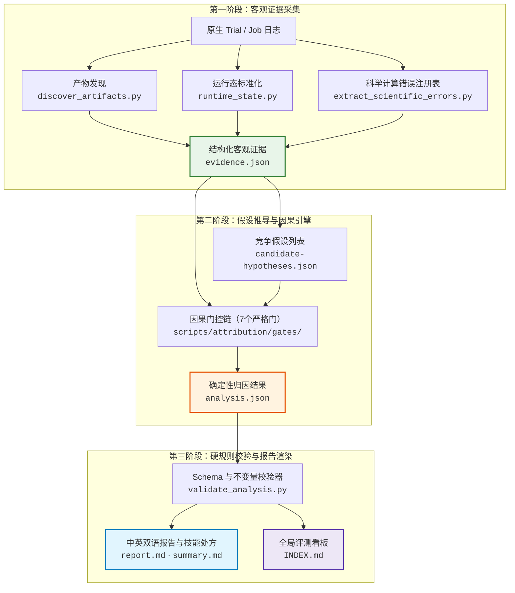

<div align="center">

# 🔬 Case Failure Analyzer (CFA)

**面向科学计算与机器学习原子间势（MLIP）基准评测的证据优先因果失败分析器**

[](pyproject.toml)
[-2ea44f?style=flat-square)](scripts/)
[](tests/)
[](scripts/attribution/)
[](LICENSE)

<br/>

[🇨🇳 简体中文](README.zh.md) &nbsp;•&nbsp; [📖 English](README.md) &nbsp;•&nbsp; [⚡ 快速开始](#-快速开始) &nbsp;•&nbsp; [🏗️ 架构与引擎](#️-架构流程与归因引擎) &nbsp;•&nbsp; [📚 文档索引](#-说明文档索引)

</div>

---

## 🌟 核心亮点：让评测失败一眼明了

CFA 杜绝模糊笼统的“智能体报错”标签，提供客观、严谨、可复核的确定性因果证据收据：

```
┌────────────────────────────────────────────────────────────────────────────────────────┐
│  1. 结构化错误矩阵   │ 检查项 · 错误性质 · 交付值 vs 复算期望值 · 偏差/容差 (超标倍数) │
│  2. 人话化核心实证   │ 将晦涩内部代码 (sci:1, ver:fail_log) 翻译为具体文件/行号清单    │
│  3. 透明可信度收据   │ 动态分子/分母标尺 (如 9/10 分) · 因子逐条计分 · 明确提分缺口   │
│  4. 四大并列因果门控 │ agent · verifier · case · infra 同等审视，先排外因再定责任      │
│  5. 自动全局看板     │ 自动更新 INDEX.md · 占未通过比例归一化 · 自然数序任务清单       │
└────────────────────────────────────────────────────────────────────────────────────────┘
```

| 核心支柱 | 评测与评审人员所见 |
|:---|:---|
| 📊 **一目了然错误矩阵** | 表格化呈现失败检查项、错误性质（数值偏差/契约ID/过程追踪）、交付值 vs 期望值、超标倍数（如 `15986.7× 超标`）与权威来源文件。 |
| 🔍 **人话化核心实证** | 将底层追踪代号（`sci:recompute_divergence:1`, `art:...`）直接翻译为人类可读的轨迹步骤、交付物行号与判定日志指针。 |
| 🎯 **透明置信度收据** | 启发式可信度收据条（如 `🟢 9/10 分`），清晰展示直接实证、反事实闭环等各项加减分因子，并在 `< 0.75` 时直接指出提分缺口。 |
| ⚖️ **四大并列大类** | 平等审视 `agent`、`verifier`、`case`、`infra` 四大板块——在将责任归于智能体之前，先通过客观事实排除评测器缺陷或环境异常。 |
| 📈 **自动化全局看板** | 自动维护 `INDEX.md`，提供三态统计（通过/已评分失败/未评分）、自然排序（`task98` < `task194`）与归一化大类分布（总和恒为 100%）。 |

---

## 🧪 支持的科学计算生态

内置覆盖 11 大科学计算与 MLIP 软件套件的 60+ 领域错误家族适配器与物理特征正则库：

| 计算领域 | 支持的模拟引擎与计算框架 |
|:---|:---|
| **DFT 与平面波计算** | `CP2K` · `Quantum ESPRESSO` · `VASP` · `ABACUS` |
| **量子化学与半经验** | `ORCA` · `Gaussian` · `PySCF` · `xTB` |
| **经典分子动力学 (MD)** | `LAMMPS` · `GROMACS` · `AMBER` · `OpenMM` |
| **机器学习原子间势 (MLIP)** | `MACE` · `NequIP` · `DeePMD-kit` · `CHGNet` · `SevenNet` |
| **化学信息学与数值基础** | `ASE` · `RDKit` · `SciPy` · `NumPy` · `JAX` · `PyTorch` · `FEniCS` · `OpenFOAM` |

---

## ⚡ 快速开始

### 统一命令行入口 (`cfa.py`)

```bash
# 1. 单任务快速审计（自动解析最新 trial，执行分析并终端打印结论卡）
python3 scripts/cfa.py audit task208 --jobs-root <benchmark checkout> --lang zh

# 2. 批量审计基准目录下全部评测任务
python3 scripts/cfa.py audit --all --jobs-root <benchmark checkout>

# 3. 只读安全检视（自动脱敏敏感凭据与本地家目录路径）
python3 scripts/cfa.py inspect task208 --section errors        # 错误矩阵与具名失败检查
python3 scripts/cfa.py inspect task208 --section confidence    # 置信度收据条与分值标尺
python3 scripts/cfa.py inspect task208 --section evidence      # 人话化证据精简摘要
python3 scripts/cfa.py inspect task208 --section verdict       # 根因速览卡片 (summary.md)

# 4. 原子加锁重新生成全局看板 (INDEX.md)
python3 scripts/cfa.py index --report-root <benchmark checkout>/failure-report
```

> 审计报告将自动落盘至 `<benchmark>/failure-report/<task_id>/`，并在同级原子维护全景看板 `<benchmark>/failure-report/INDEX.md`。

---

## 🖥️ 实机终端效果预览

执行 `cfa audit task208` 时，CFA 会直接在终端输出结构完整、开箱即答的 Markdown 结论卡：

```markdown
# task208 — 根因速览 (Root Cause Verdict)

**裁定**: `failed` · **主根因**: 智能体决策与执行失误 (`agent`) / `result_validation` / `AGENT_RESULT_VALIDATION`（置信度 **0.90**）
**可信度拆解**: 🟢 `9/10 分` · ✓ 直接因果实证 (2项)(+2) · ✓ 跨源证据互证(+1) · ✓ 唯一阻断项反事实闭环(+2) · ✓ 偏差超容差 1.599e+04×(+2) · ✓ 单项检查精准定位(+1) · ✓ 竞争假设区分度高(+1)

**失败原因 (Why it failed)**: [L3] neutral_stationary: R02-M01/site000003 charge differs from independent frozen EQeq replay by 1.59869e-06 e beyond its decimal serialization bound 1.00001e-10 e

## 1. 四大类裁决 (Four Peer Categories)
| 大类 | 裁决 | 依据 |
|---|---|---|
| `agent` 智能体决策与执行失误 | **主因** | Agent 交付的 'charge' = 0.898982845013923 与验证器独立复算相差 1.59869e-06，超出容差上限 1.00001e-10。 |
| `verifier` 评测验证与规则判定缺陷 | **已排除** | 失败检查明确指出了指标容差，并在产物中定位到了交付值；属于交付数值错误而非复算缺陷。 |
| `case` 基准题目与规格设计缺陷 | **未选为主因** | 契约审计未发现题目资产缺失或规格歧义。 |
| `infra` 运行环境与系统设施缺陷 | **未选为主因** | 未检出因果性 infra 观测；容器构建与验证器均正常运行完毕。 |

## 2. 具名失败检查与错误矩阵 (Error Matrix)
| 检查项 | 错误性质 | 交付值 vs 复算/期望值 | 偏差 / 容差 (超标倍数) | 说明与来源 |
|---|---|---|---|---|
| `[L3] neutral_stationary` | 数值偏差 | `0.898982845013923` vs `独立复算重放` | Δ = 1.59869e-06 / tol 1.00001e-10 (15986.7× 超标) | R02-M01/site000003 charge differs from frozen EQeq replay (来源: `raw-verifier.json`) |
```

---

## 🏗️ 架构流程与归因引擎

### 流水线流向图



### 7-Gate 因果归因门控阶梯

由 `scripts/attribution/engine.py` 严格按序执行，最先命中的门生效并终止链条：

```text
Gate 0: 全量规则通过        ──▶ 用例验证通过，生成轻量无噪通过报告（<30 行）
  ↓ (未通过)
Gate 1: 环境与未启动异常    ──▶ 容器启动前失败 / 无日志异常终止（绝不怪罪未启动的 Agent）
  ↓ (Agent 启动成功)
Gate 2: 基准题目设计缺陷    ──▶ 任务资产丢失、题干规格错误、存在歧义的私有约定
  ↓ (题目规格无瑕疵)
Gate 3: 评测验证器自身缺陷  ──▶ 验证脚本崩溃、正则解析溢出、超紧容差微扰碰撞
  ↓ (验证器判定有效)
Gate 4: 独立复算数值偏离    ──▶ 严谨数值重算超差、偏差超标倍数计算、截断参数权衡捕获
  ↓ (未命中数值复算偏离)
Gate 5: 充分有效证据校验    ──▶ 证据不充分时归入 unknown，绝不盲目归因责任
  ↓ (存在确定性 Agent 偏离证据)
Gate 6: 智能体主观决策失误  ──▶ 产物结构/引用ID不符、自检覆盖不足、未经核验即交付
```

---

## 💻 命令行参考与进阶选项

<details>
<summary><b>🔍 点击展开 <code>cfa.py</code> 详细子命令与检视参数</b></summary>

### `cfa.py` 命令一览

| 子命令 | 用途说明 | 核心参数 |
|:---|:---|:---|
| `audit` | 解析目标 Trial，运行完整流水线并输出结论卡。 | `<task_id>`, `--all`, `--jobs-root <dir>`, `--lang zh\|en\|bilingual` |
| `inspect` | 对已完成的任务进行只读脱敏检视。 | `<task_id>`, `--section verdict\|errors\|confidence\|evidence`, `--raw` |
| `index` | 原子加锁重新生成全局 `INDEX.md` 看板。 | `--report-root <dir>` |

### `cfa inspect` 视图说明

- `--section verdict`: 输出标准根因速览卡片（`summary.md`）。
- `--section errors`: 输出一目了然错误矩阵，含检查项层级、性质、交付值、复算偏差与超标倍数。
- `--section confidence`: 输出透明计分收据条（`points / denominator`）、各项正负因子与提分缺口。
- `--section evidence`: 输出精简的运行态、检查项计数、因果锚点与行为信号，无需在终端查看动辄 200KB+ 的全量 JSON。
- `--raw`: 输出对应部分的原生无格式 JSON 数据，便于脚本流式处理。

</details>

<details>
<summary><b>🛠️ 点击展开底层路径模式 (<code>analyze_case.py</code>) 与模型在环校验</b></summary>

### 手动指定路径模式

```bash
python3 scripts/analyze_case.py \
  --job jobs/<job_name> \
  --task tasks/<task_name> \
  --output <output-dir>/<case_id> \
  --lang bilingual
```

| 参数名称 | 类型 | 说明 |
|:---|:---|:---|
| `--job` | Path | 作业目录或具体 Trial 目录 **（必选）**。 |
| `--output` | Path | 产物输出目录；严格禁止与输入路径重叠 **（必选）**。 |
| `--task` | Path | 任务定义目录（省略时自动搜寻上级 `task.toml`）。 |
| `--trial` | String | 指定分析的 Trial 名称或 `all`（默认：`all`）。 |
| `--lang` | Choice | `bilingual`（默认，中英双语合订）、`zh`（独立中文）或 `en`（独立英文）。 |
| `--format` | Choice | `both`（默认）、`json` 或 `markdown`。 |
| `--phase` | Choice | `all`（全流水线）或 `collect`（仅采集客观证据与候选假设）。 |

### 输出目录结构

在 `<output-dir>/<case_id>/` 目录下生成：
- `summary.md`: 纯净 Markdown 结论卡，与终端输出逐字节一致。
- `report.md`: 核心 4 板块因果审计主报告（通过用例自动缩减为 `< 30` 行）。
- `skill-prescription.md`: 针对智能体能力盲区生成的技能处方规范（按需生成）。
- `data/evidence.json`: 结构化时间线、运行状态与软件错误观测。
- `data/analysis.json`: 机器可读的最终因果归因结论（`failure-analysis-v1`）。
- `data/summary.json`: 结构化结论卡元数据。

### 模型在环 (Model-in-the-Loop) 校验工作流

若要提交或复核大语言模型编写的归因推导，可使用内置校验器进行防御性审计：

```bash
# 1. 对比客观证据与不变量，校验归因推导
python3 scripts/validate_analysis.py \
  --evidence <output-dir>/<case_id>/evidence.json \
  --analysis <output-dir>/<case_id>/analysis.json \
  --report   <output-dir>/<case_id>/report.md

# 2. 渲染正式报告
python3 scripts/render_report.py \
  --evidence <output-dir>/<case_id>/evidence.json \
  --analysis <output-dir>/<case_id>/analysis.json \
  --output-report <output-dir>/<case_id>/report.md \
  --lang bilingual
```

</details>

---

## 📁 仓库结构说明

```text
case-failure-analyzer/
├── SKILL.md                 # Agent 运行时入口与系统提示词契约（专供 Agent）
├── README.md / README.zh.md # 项目说明文档（英文 | 简体中文双语版）
├── Makefile                 # 工程化入口：test、lint、format、check-docs、export-skill
├── pyproject.toml           # 项目元数据配置（标准库原生，Python >= 3.9）
├── docs/{en,zh}/            # references/ 的人类可读中英文镜像文档
├── references/              # 专供 Agent 读取的唯一领域知识源
│   ├── taxonomy.md          # 失败分类学体系
│   ├── attribution-protocol.md # 因果归因执行协议
│   ├── error-families.json  # 跨 11 个套件的 60+ 科学计算错误正则特征库
│   └── software/*.md        # 分软件知识库（CP2K, VASP, LAMMPS 等）
├── scripts/                 # 轻量标准库 Python 脚本集
│   ├── cfa.py               # 统一命令行客户端 (audit, inspect, index)
│   ├── analyze_case.py      # 流水线执行主脚本
│   ├── staging.py           # 原子暂存、文件建议锁与清单事务发布机制
│   ├── render_report.py     # Markdown 审计报告与技能处方渲染器
│   ├── report_style.py      # 双语术语、错误矩阵与格式化唯一规范
│   └── attribution/         # 7 门归因决策引擎
└── tests/                   # 384 项单元测试、决策表与特征化测试
```

---

## 🔧 开发与自动化测试

运行时严谨保持**标准库原生（零三方依赖）**。工程与测试工具链开箱即用：

```bash
make test          # 运行全套单元测试（384 项测试全绿，无需额外配置环境）
make check         # 全方位质量门禁：语法检查 + 单元测试 + 文档镜像同步 + 代码格式
make smoke         # 在提交的真实回归 fixture 上执行端到端 CLI 冒烟验证
make export-skill  # 导出干净的生产技能目录，排除测试与开发冗余文件
```

### 生产技能目录导出

```bash
# 导出到默认技能目录 ($CODEX_HOME/skills/case-failure-analyzer)
make export-skill

# 或导出到指定目标目录
make export-skill DEST=/path/to/target/case-failure-analyzer
```

---

## 📚 说明文档索引

| 文档名称 | 简体中文版 (`docs/zh/`) | English Mirror (`docs/en/`) |
|:---|:---:|:---:|
| **项目概览与命令行指南** | [README.zh.md](README.zh.md) | [README.md](README.md) |
| **系统工作流与归因总规范** | [guide.md](docs/zh/guide.md) | [guide.md](docs/en/guide.md) |
| **失败分类学体系 (`failure-analysis-v1`)** | [taxonomy.md](docs/zh/taxonomy.md) | [taxonomy.md](docs/en/taxonomy.md) |
| **逆向因果归因协议** | [attribution-protocol.md](docs/zh/attribution-protocol.md) | [attribution-protocol.md](docs/en/attribution-protocol.md) |
| **证据与归因 JSON 模式规范** | [evidence-schema.md](docs/zh/evidence-schema.md) | [evidence-schema.md](docs/en/evidence-schema.md) |
| **审计报告结构规范（4 大核心板块）** | [report-schema.md](docs/zh/report-schema.md) | [report-schema.md](docs/en/report-schema.md) |
| **领域技能处方生成策略** | [skill-prescription-policy.md](docs/zh/skill-prescription-policy.md) | [skill-prescription-policy.md](docs/en/skill-prescription-policy.md) |

---

<div align="center">

Made with 🔬 for rigorous, evidence-grounded AI scientific computing evaluation.

</div>
