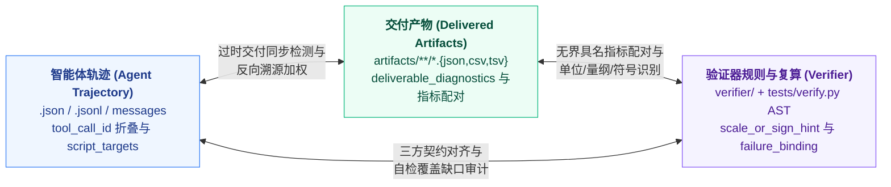
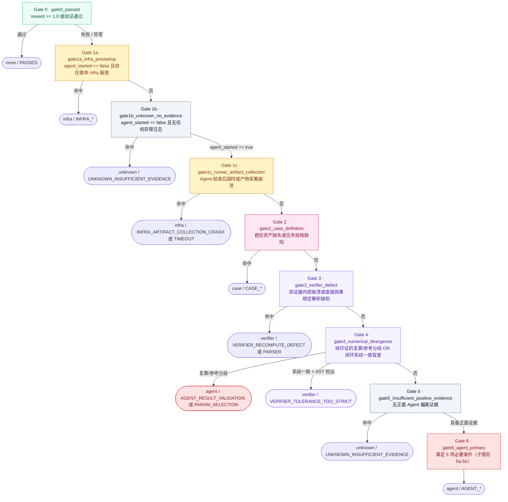

<div align="center">

# Case Failure Analyzer · 用例失败归因

**面向科学计算基准的证据闭环因果审计与根因归因引擎**

[](pyproject.toml)
[](pyproject.toml)
[](docs/zh/taxonomy.md)
[](references/error-families.json)
[](docs/zh/evidence-schema.md)
[](SKILL.md)

[English](README.md) · [技能定义](SKILL.md) · [使用指南](docs/zh/guide.md)

[三方闭环交叉核对](#三方闭环交叉核对) · [快速开始](#快速开始) · [Gate 0–6 短路归因漏斗](#gate-06-短路归因漏斗) · [CLI 速查与报告产物](#cli-速查与报告产物) · [科学软件覆盖](#科学软件覆盖11-组套件--60-类错误家族) · [文档索引](#文档索引)

</div>

<p align="center"></p>

---

Case Failure Analyzer（CFA）对科学计算基准测试试次进行严格事后只读审计。它综合解析运行器日志、多格式智能体轨迹、任务契约、验证器代码与结构化评测结果以及采集交付物，生成确定性的根因速览裁决卡、中英双语因果审计报告与机器可读证据图谱。

> **运行要求与安全边界** · Python 3.9+ · 运行时零第三方依赖（纯标准库）· 输入目录（`jobs/`、`tasks/`、`tests/verify.py`）保持严格只读。

---

## 三方闭环交叉核对

CFA 不凭孤立关键词定罪，也不在其它门控未命中时默认责怪智能体，而是在**智能体轨迹、交付产物与验证器规则**之间构建三方闭环交叉核对：



- **轨迹规整化与因果溯源**：统一解析 `ATIF`、`.jsonl` 与 OpenAI/Anthropic `tool_use` / `tool_result` 流并经由 `tool_call_id` 跨步折叠；截断观测时在中段保留最多 6 条高显著性报错/指标行；追踪两阶段脚本写入目标（`script_targets`）并在 `Bash` 无错执行后绑定至 `written_files`；对关联失败产物的脚本赋予 `+15` 反向溯源加权并提取跨步 `parameter_evolution`（`initial` → `final`）。
- **交付物完整性与指标核对**：不设人造偏差阈值上限地将具名失败检查配对至 `artifacts/` 数值行，自动探测物理单位换算（`scale_or_sign_hint`：Hartree/eV、kcal/kJ、Bohr/Å、十进制数量级、符号反转），识别轨迹已算出复算值但交付物未同步更新的 `stale_deliverable_sync`，并扫描空表、`NaN`/`Inf` 与 `checked_keys` 缺失（`deliverable_diagnostics`）。

**任务 ID 模式核心产物**

| 归因裁决卡 | 证据追溯图谱 | 批量总览看板 |
| :--- | :--- | :--- |
| 四大类对比裁决与核心因果链锚点 | 定位具名失败检查、日志、交付物与执行步骤 | 汇总已评分通过、已评分失败与未评分试次 |
| `summary.md` | `data/evidence.json` | `INDEX.md` |

---

## 快速开始

将 `BENCH_ROOT` 设为包含 `jobs/` 与 `tasks/` 的基准测试仓库路径（或配置环境变量 `CFA_JOBS_ROOT`）：

```bash
BENCH_ROOT="/path/to/benchmark"

# 1. 审计单个任务（终端直接打印四段式速览裁决卡与 REPORT_DIR）
python3 scripts/cfa.py audit task208 --jobs-root "$BENCH_ROOT" --lang zh

# 2. 只读脱敏检视已保存的审计结果（errors | confidence | artifacts | step）
python3 scripts/cfa.py inspect task208 --jobs-root "$BENCH_ROOT" --section errors
python3 scripts/cfa.py inspect task208 --jobs-root "$BENCH_ROOT" --section artifacts
python3 scripts/cfa.py inspect task208 --jobs-root "$BENCH_ROOT" --section step --step 43

# 3. 对比两个任务或同一任务的两次试次差异
python3 scripts/cfa.py diff task207 task208 --jobs-root "$BENCH_ROOT"

# 4. 自动发现全量用例并按自然数序批量审计、原子重建 INDEX.md
python3 scripts/cfa.py audit --all --jobs-root "$BENCH_ROOT" --lang zh
```

<details>
<summary><strong>实时裁决卡预览（四段式标准输出格式）</strong></summary>

每次运行 `cfa.py audit <task_id>` 都会向 stdout 打印结构一致的四段式裁决卡（并写入 `summary.md`），按**主因裁决 → 1. 四大类裁决 → 2. 主因大类下的小分类 → 核心因果链锚点**的固定顺序呈递：

```markdown
# task208 — 根因速览 (Root Cause Verdict)

**裁定**: `failed` · **主根因**: 智能体决策与执行失误 (`agent`) / `result_validation` / `AGENT_RESULT_VALIDATION`（置信度 **0.82**）
**可信度拆解**: 🟢 `8/10 分` · ✓ 具名失败检查(+3) · ✓ 轨迹执行锚点(+3) · ✓ 正向偏离信号(+2)

**失败原因 (Why it failed)**: [L3] total_energy_error: 交付值 -15.42 与复算值 -419.60 存在量纲换算差异（Hartree <-> eV 27.211386）

> 判定门控 / Gate: `gate4_numerical_divergence` · 完整报告：`task208.md`（同目录）

## 1. 四大类裁决 (Four Peer Categories)

| 大类 | 裁决 | 依据 |
|---|---|---|
| `agent` 智能体决策与执行失误 | **主因** | Agent 以 Hartree 输出总能而未换算为 eV（`AGENT_RESULT_VALIDATION`） |
| `verifier` 评测验证与规则判定缺陷 | **未选为主因** | 验证器执行并给出 1 项具名失败检查（`total_energy_error`），未检出验证器自身缺陷 |
| `case` 基准题目与规格设计缺陷 | **未选为主因** | 契约审计未发现题目资产缺失或规格歧义 |
| `infra` 运行环境与系统设施缺陷 | **已排除** | 容器构建与 Agent 执行均正常，验证器也已完成判定（`runtime.agent_started == true`） |

## 2. 主因大类下的小分类 (Subcategory under `agent`)

| 角色 | 小分类 (subtype) | 编码 (code) | 置信度 | 依据 |
|---|---|---|---|---|
| 主因 | 结果后处理与校验 (`result_validation`) | `AGENT_RESULT_VALIDATION` | 0.82 | 轨迹与 `artifacts/app/results.json` 闭环印证单位换算偏差（`Hartree <-> eV`） |

### 核心因果链锚点

- **参数与算法定义**: `trajectory:step:9` (`Write`: `run_dft.py`)
  - **参数演化**: `ecutwfc`: `30` (`trajectory:step:4`) -> `80` (`trajectory:step:9`)
- **交付物生成执行**: `trajectory:step:14` (`Bash`: `python3 run_dft.py`)
- **自检覆盖**: `trajectory:step:16` (`Bash`: `python3 self_check.py`)
  - **自检结果**: 通过 `VERIFY OK` · **已覆盖**: `schema_ok` · **未覆盖**: `total_energy_error`
```

</details>

<details>
<summary><strong>任务解析、检视选项与可运行的回归测试示例</strong></summary>

- **任务引用解析**：`task208` 默认匹配修改时间最新的试次；用引号传入完整名称（如 `"task 208__jaekojA"`）可锁定指定试次。未显式传 `--jobs-root` 时依次探测 `$CFA_JOBS_ROOT`、当前目录及父目录。
- **只读脱敏检视**：`cfa.py inspect` 默认自动遮盖用户主目录路径与常见 API 密钥/凭据（可通过 `--no-redact` 关闭；通过 `--raw` 输出原生 JSON 或未格式化文本）。
- **直接目录模式与可运行回归示例**：

```bash
REPORT_DIR="$(mktemp -d)"
python3 scripts/analyze_case.py \
  --job tests/fixtures/regressions/mixed-job-success-trial/job \
  --output "$REPORT_DIR" \
  --lang zh
cat "$REPORT_DIR/job_summary.md"
```

该回归夹具包含 **1 个已评分通过、0 个已评分失败和 1 个未评分试次**（整体通过率 **50.0%**，已评分通过率 **100.0%**；未评分试次归因代码为 `UNKNOWN_INSUFFICIENT_EVIDENCE`）。

</details>

---

## Gate 0–6 短路归因漏斗

CFA 严格按时间依赖与因果先后顺序评估门控；首个命中的门控立即短路输出结论，并在 `data/analysis.json` 中完整记录 `decision_trace`：



### 四大并列归因类别

| 并列类别 | 审计审查范围 | 辅助类别 |
| :--- | :--- | :--- |
| **`agent`** · 智能体决策与执行失误 | 方法选择、参数/截断设置、任务契约履行、工作流编排及自检覆盖缺口 | — |
| **`verifier`** · 评测验证与规则判定缺陷 | 内部复算崩溃、直接因果绑定解析缺陷（`failure_binding == "direct"`）、隐藏契约与过严数值容差 | — |
| **`case`** · 基准题目与规格设计缺陷 | 缺失或损坏的任务资产、需求歧义、矛盾参考真值与不合理计算配额 | — |
| **`infra`** · 运行环境与系统设施缺陷 | 容器/启动前构建失败、网络超时、OOM、Agent 结束后运行器中断及产物采集崩溃 | `unknown`（证据不足）· `none`（已通过） |

### 门控优先级速览表

| 门控 | 标识 (`gate_id`) | 核心触发条件 | 归因类别 |
| :--- | :--- | :--- | :--- |
| **Gate 0** | `gate0_passed` | `verification_status == "passed"` 或 `reward >= 1.0` | `none` |
| **Gate 1 (1a / 1b)** | `gate1a_infra_prestartup` / `gate1b_unknown_no_evidence` | `agent_started == false` 且存在致命 infra 日志（`1a`）或无日志静默失败（`1b`） | `infra` / `unknown` |
| **Gate 1c** | `gate1c_runner_artifact_collection` | Agent 结束后、验证器前的 Harbor 运行器故障（`INFRA_AGENT_TIMEOUT`、`INFRA_ARTIFACT_COLLECTION_CRASH`、`INFRA_RUNNER_INTERRUPTED`） | `infra`（试次未评分） |
| **Gate 2** | `gate2_case_definition` | 题目资产缺失或 Dockerfile/题目定义损坏 | `case` |
| **Gate 3** | `gate3_verifier_defect` | 验证器未捕获崩溃（`VERIFIER_RECOMPUTE_DEFECT`、`ENV_INVALID` / `scorable: false`）或直接因果绑定解析缺陷 | `verifier` |
| **Gate 4** | `gate4_numerical_divergence` | 经印证的验证器复算/参考分歧（`agent`），**或**三方闭环证明系综均值一致而瞬时轨迹容差过严（`verifier`） | `agent`（`AGENT_RESULT_VALIDATION` / `AGENT_SCIENTIFIC_PARAMETER_SELECTION`）或 `verifier`（`VERIFIER_TOLERANCE_TOO_STRICT`） |
| **Gate 5** | `gate5_insufficient_positive_evidence` | 试次失败但缺乏正面 Agent 偏离证据（仅有 `reward == 0` 绝不归责智能体） | `unknown` |
| **Gate 6** | `gate6_agent_primary` | 满足全部 5 项必要条件并具备正面轨迹/契约/科学误差证据（子情形 `5a`–`5e`） | `agent` |

> [!IMPORTANT]
> **防误判硬性约束（Anti-False-Blame Hard Rules）**
> - **启动前边界**：只要 `runtime.agent_started == false`，**严禁**归因 `agent`，只能裁决为 `infra` 或 `unknown`。
> - **验证器未运行边界**：当 `verifier_started == false` / `reward == null` 时，单一 `sig:premature_completion` 启发式不构成正面 `agent` 证据；Gate 1c 中的运行器超时/采集崩溃必须以 `infra` 为主因（缺失交付物仅保留为伴随因素），且绝不计为已评分失败。
> - **差值偏差完整性（Delta Divergence Integrity）**：仅从 `artifacts/` 中完整匹配验证器行标识符的结构化记录绑定 `agent_reported_value`；严禁把验证器打印的差值（delta）当作智能体交付值，亦严禁以 `final_response` / `agent_thought` 充当执行印证。
> - **首次偏离点执行锚点约束（FUD Execution Anchor）**：归因 `agent` 时，`first_unrecovered_deviation.event_ref` 必须指向执行锚点（`deliverable_generation` 或 `algorithm_or_param_definition`），严禁指向最终回复步骤。

---

## CLI 速查与报告产物

### CLI 命令速查表

| 命令 | 用途 | 常用参数 |
| :--- | :--- | :--- |
| `cfa.py audit <task_id>` | 按任务 ID 执行审计并打印速览裁决卡 | `--jobs-root`、`--report-dir`、`--lang {bilingual,zh,en}`、`--format {both,json,markdown}`、`--no-verdict-stdout` |
| `cfa.py audit --all` | 按自然数序批量审计全量任务并重建 `INDEX.md` | `--jobs-root`、`--lang`、`--verdict-stdout`、`--archive-evidence` |
| `cfa.py inspect <task_id>` | 只读脱敏检视已保存的审计结论与证据细节 | `--section {verdict,report,errors,confidence,evidence,anchors,artifacts,step,data}`、`--step <id>`、`--raw`、`--no-redact` |
| `cfa.py diff <a_or_task> [b]` | 对比两个任务或同一任务两个试次的裁决、失败检查与因果锚点 | `--trials <t1> <t2>`、`--jobs-root`、`--report-dir`、`--raw`、`--no-redact` |
| `cfa.py index` | 原子化重算全局看板 `failure-report/INDEX.md` | `--report-root` |
| `analyze_case.py` | 对显式作业/试次目录运行分析（亦支持 `--task-id`） | `--job`、`--task`、`--trial`、`--output`、`--phase {all,collect}`、`--max-log-bytes`、`--include-session-files` |

### 报告目录结构

任务 ID 模式的典型目录（`--lang zh --format both`）：

```text
failure-report/
├── INDEX.md                      # 全局三态看板（已评分通过 / 已评分失败 / 未评分）
└── task208/
    ├── task208.md                # 带证据锚点的完整因果审计报告
    ├── summary.md                # 四段式速览裁决卡（与 stdout 完全一致）
    ├── skill-prescription.md     # 仅当主因为 agent 且存在可复用能力缺口时按需生成
    ├── trials/                   # 轻量多试次归档（加 --archive-evidence 可保存全量 JSON）
    └── data/
        ├── evidence.json         # 规整化运行态、时间线、交付物诊断与交叉核对观测
        ├── candidate-hypotheses.json
        ├── analysis.json         # failure-analysis-v1 归因结论与 decision_trace
        └── summary.json          # 结构化速览卡片元数据
```

如需人工微调 `analysis.json`，可用 `scripts/validate_analysis.py` 对照证据校验硬性规则，再用 `scripts/render_report.py` 重新渲染报告。

---

## 科学软件覆盖（11 组套件 / 60 类错误家族）

全部错误签名均以 [`references/error-families.json`](references/error-families.json) 为单一真值源，并在 [`references/software/`](references/software/) 下配套判别证据指南：

| 套件 | 适用领域与软件 | 错误家族数 | 知识库文档 |
| :--- | :--- | :---: | :--- |
| `cp2k` | 混合高斯/平面波 DFT 与从头算分子动力学 (`CP2K`) | 8 | [cp2k.md](references/software/cp2k.md) |
| `quantum-espresso` | 平面波 DFT / DFPT (`pw.x`, `bands.x`, `dos.x`, `ph.x`) | 6 | [quantum-espresso.md](references/software/quantum-espresso.md) |
| `vasp-abacus` | 固态平面波与局域基 DFT (`VASP`, `ABACUS`, `GPAW`, `Siesta`, `FHI-aims`) | 5 | [vasp-abacus.md](references/software/vasp-abacus.md) |
| `orca-gaussian-pyscf` | 分子量子化学 (`ORCA`, `Gaussian`, `PySCF`, `Psi4`, `Q-Chem`, `NWChem`) | 5 | [orca-gaussian-pyscf.md](references/software/orca-gaussian-pyscf.md) |
| `lammps` | 经典与反应力场分子动力学 (`LAMMPS`) | 8 | [lammps.md](references/software/lammps.md) |
| `gromacs-amber-openmm` | 生物分子动力学 (`GROMACS`, `AMBER`, `OpenMM`, `NAMD`, `CHARMM`) | 4 | [gromacs-amber-openmm.md](references/software/gromacs-amber-openmm.md) |
| `mlip` | 机器学习原子间势 (`MACE`, `NequIP`, `Allegro`, `DeePMD-kit`, `CHGNet`, `SevenNet`, `Orb`) | 5 | [mlip.md](references/software/mlip.md) |
| `ase` | 原子模拟工作流与计算器 (`ASE`, `pymatgen`) | 5 | [ase.md](references/software/ase.md) |
| `xtb` | 半经验量子化学与构象搜索 (`xTB`, `CREST`) | 5 | [xtb.md](references/software/xtb.md) |
| `rdkit` | 化学信息学与构象生成 (`RDKit`) | 5 | [rdkit.md](references/software/rdkit.md) |
| `generic-scientific` | 数值求解器与偏微分方程 (`SciPy`, `NumPy`, `JAX`, `PyTorch`, `FEniCS`, `OpenFOAM`) | 4 | [generic-scientific.md](references/software/generic-scientific.md) |

---

## 仓库结构与开发

| 路径 | 用途 |
| :--- | :--- |
| [`SKILL.md`](SKILL.md) · [`agents/openai.yaml`](agents/openai.yaml) | 技能执行规范与界面元数据 |
| [`scripts/`](scripts/) · [`scripts/attribution/`](scripts/attribution/) | 统一 CLI、轨迹规整化、交叉核对、Gate 0–6 引擎、校验与渲染器 |
| [`references/`](references/) · [`docs/`](docs/) | 单一真值源协议规范与中英文镜像文档 |
| [`tests/`](tests/) | 单元测试、门控特征测试、CLI 测试及回归夹具 |

```bash
make test          # 零依赖运行全量 unittest 测试
make check-docs    # 校验 docs/en 镜像与 references/ 一致性及指南语言头完整性
make smoke         # 基于内置回归夹具运行端到端冒烟测试
make check         # 完整检查：lint (ruff) + test + check-docs + format-check
make export-skill DEST=/path/to/skills/case-failure-analyzer
```

---

## 文档索引

| 主题 | 简体中文 | English |
| :--- | :--- | :--- |
| 工作流与使用方法 | [使用指南](docs/zh/guide.md) | [Guide](docs/en/guide.md) |
| 根因类别 | [根因分类](docs/zh/taxonomy.md) | [Taxonomy](docs/en/taxonomy.md) |
| 判定顺序与证据要求 | [归因协议](docs/zh/attribution-protocol.md) | [Attribution protocol](docs/en/attribution-protocol.md) |
| 机器可读字段 | [证据结构](docs/zh/evidence-schema.md) | [Evidence schema](docs/en/evidence-schema.md) |
| Markdown 产物 | [报告规范](docs/zh/report-schema.md) | [Report schema](docs/en/report-schema.md) |
| 可复用的智能体能力缺口 | [技能处方策略](docs/zh/skill-prescription-policy.md) | [Skill prescription policy](docs/en/skill-prescription-policy.md) |
