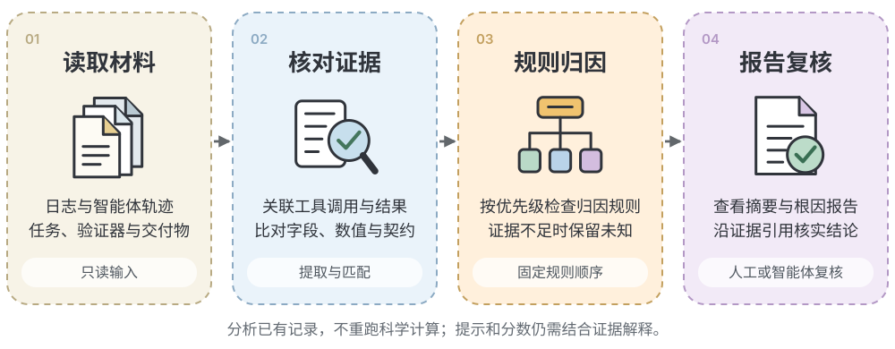
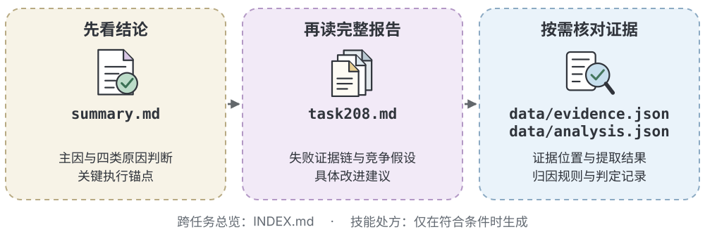

# Case Failure Analyzer

[English](README.md) · 简体中文

Case Failure Analyzer（CFA）读取科学计算基准的试次记录，定位运行在哪一步中断，或哪项检查拒绝了提交。证据充分时，报告会指出原因来自智能体决策、验证器、题目设计还是运行环境。有些试次能定位到出错的字段，但现有材料仍不足以判断责任。

对归因于智能体的失败，还可以审查具体决策涉及的能力，例如物理建模、后处理或独立验证。[八个能力维度](docs/zh/taxonomy.md#agent-capability-dimensions) · [案例试标](docs/zh/agent-capability-pilot.md)



需要 Python 3.9+，无第三方运行时依赖。只核验已有产物及测评验证记录，不追加复算；报告支持中文、英文和双语。

## 使用

从本仓库根目录导出到所用客户端的技能目录（[安装位置](docs/zh/guide.md#安装与调用)）：

```bash
python3 scripts/export_skill.py --dest /path/to/skills/case-failure-analyzer
```

在智能体聊天中调用；不支持技能发现的客户端可直接读取导出目录中的 `SKILL.md`：

```text
使用 case-failure-analyzer 分析 task208，基准仓库是 /path/to/benchmark。
请用中文核验缺失产物、关联已有验证记录，说明候选原因和证据缺口。
```

也可以直接在终端运行：

```bash
python3 scripts/cfa.py audit task208 --jobs-root /path/to/benchmark --lang zh
```

需要独立英文版时使用 `--lang bilingual`：任务号模式输出 `<task_id>.en.md`，显式路径模式输出 `report.en.md`；无语言后缀的文件是主报告，不代表英文版。

将示例路径换成包含 `jobs/` 与 `tasks/` 的基准仓库路径。任务编号默认匹配修改时间最新的试次。指定试次、批量分析、结果检视、对比与更新方法见[使用指南](docs/zh/guide.md)。

## 输出

按任务号审计时，报告写入 `<benchmark>/failure-report/<job>/<task_id>/`，终端或聊天中会显示归因摘要。用 `inspect --section errors` 可查看运行中断或评分拒绝的原始记录。如果能唯一匹配，报告还会列出评分条件和提交值。



在 CompChemWorld 两批共 196 个试次中，126 个失败或异常试次都能定位到中断或评分拒绝，其中 95 个有规则支持的候选根因。[验收结果与案例](docs/zh/compchemworld-validation.md)

## 文档

[安装与调用](docs/zh/guide.md#安装与调用) · [根因分类](docs/zh/taxonomy.md) · [归因规则](docs/zh/attribution-protocol.md)

[证据字段](docs/zh/evidence-schema.md) · [报告格式](docs/zh/report-schema.md) · [技能处方](docs/zh/skill-prescription-policy.md) · [已有证据审查](docs/zh/evidence-review.md) · [技能定义](SKILL.md)

[脚本职责](scripts/README.md) · [随技能导出的参考索引](references/README.md)
