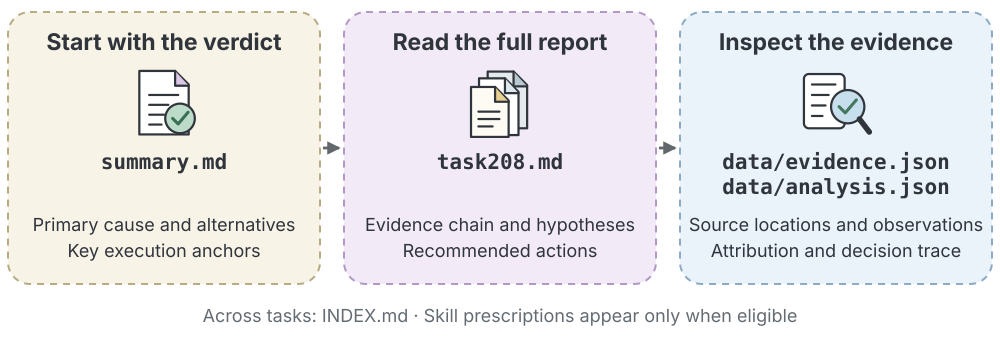

# Usage guide

**[English](guide.md) | [简体中文](../zh/guide.md)** · [Project home](../../README.md) · [Guide](guide.md)

<a id="case-failure-analyzer--system-guide--workflow-specification"></a>

**On this page:** [Installation and invocation](#installation-and-invocation) · [Inputs](#inputs) · [Default Behavior & Boundaries](#default-behavior--boundaries) · [Workflow](#workflow) · [Attribution Constraints (Hard Rules)](#attribution-constraints-hard-rules) · [Scientific software error signatures](#scientific-software-error-signatures) · [Development and export](#development-and-export) · [Harbor discovery and result review](#harbor-discovery-and-result-review)

This guide covers installation, invocation, and report review. The agent follows `SKILL.md` to organize the audit and answer; Python scripts extract evidence, apply attribution rules, and write reports.

## Installation and invocation

<a id="install-in-codex"></a>

### Install in different clients

Scripts require Python 3.9+ and no third-party runtime packages. The portable skill consists of `SKILL.md`, `scripts/`, and `references/`. `agents/openai.yaml` supplies Codex UI metadata; other clients do not need it to run the workflow.

| Client | Common local location | Invocation |
| --- | --- | --- |
| Codex | `~/.agents/skills/case-failure-analyzer/` | `$case-failure-analyzer` |
| Claude Code | `~/.claude/skills/case-failure-analyzer/` or project `.claude/skills/` | `/case-failure-analyzer` |
| Cursor | `~/.cursor/skills/case-failure-analyzer/` or project `.cursor/skills/` | Select the skill in the `/` menu or name it in the request |
| GitHub Copilot | Project `.github/skills/case-failure-analyzer/`; supported local surfaces also accept `~/.copilot/skills/` | Use the surface's skill entrypoint or a natural-language request |
| Other agents with file and Python access | Any accessible exported directory | Ask the agent to read its `SKILL.md` and follow the workflow |

Locations follow the current client documentation: [Codex](https://learn.chatgpt.com/docs/build-skills), [Claude Code](https://code.claude.com/docs/en/skills), [Cursor](https://cursor.com/docs/skills), and [GitHub Copilot](https://docs.github.com/en/copilot/concepts/customizations/agent-skills). Cloud, remote, and organization-managed surfaces may not read your local user directory; use the location supported by that surface.

Export from this source checkout, for example:

```bash
python3 scripts/export_skill.py --dest "$HOME/.claude/skills/case-failure-analyzer"
```

Change `--dest` for your client. The export includes `SKILL.md`, `agents/`, `scripts/`, and `references/`, excluding tests, local reports, and documentation pages. Project-scoped installation must target the benchmark checkout rather than this source repository; the exporter enforces path boundaries. The historical `make export-skill` default remains `$CODEX_HOME/skills/case-failure-analyzer`, so pass the destination explicitly.

### Invoke in a chat

Name the skill and provide a task reference and an accessible benchmark path. The natural-language examples below are harness-neutral; use the native invocation prefix from the table when available.

```text
Use case-failure-analyzer to analyze task208 in /path/to/benchmark.
Explain the primary cause and the evidence for all four categories in English,
and link the full report.
```

A task number selects the most recently modified matching trial. To select one run, provide its full trial name:

```text
Use case-failure-analyzer to analyze trial "task 208__jaekojA" in
/path/to/benchmark. Preserve the inputs and produce an English attribution report.
```

You can also provide explicit job and task directories:

```text
Use case-failure-analyzer to audit /path/to/benchmark/jobs/run-001,
with task definitions at /path/to/benchmark/tasks/task208.
Write reports to /path/to/benchmark/failure-analysis/run-001.
```

An agent can match a natural-language request to the skill. Explicit invocation makes the intended workflow clear. For a batch audit:

```text
Use case-failure-analyzer to audit every task under /path/to/benchmark,
produce English reports, and update failure-report/INDEX.md.
```

Task-ID mode returns an attribution summary in the chat and links to `failure-report/<task_id>/<task_id>.md`. See the [report schema](report-schema.md) for output files and optional skill-prescription conditions.



### Update and troubleshoot

After updating the source checkout, run the same export command again. By default it does not delete unrelated destination files. To remove obsolete managed files, preview with `--clean --dry-run`, then use `--clean`; cleanup is limited by the export manifest.

| Symptom | What to check |
| --- | --- |
| Skill does not appear | The installation contains `SKILL.md`, `scripts/`, and `references/`, and the client has detected the update |
| Duplicate skill names | Both the user and project directories may contain a copy |
| Task cannot be found | Provide an absolute benchmark path; check `jobs/`, the task number, or the full trial name |
| Scripts run but the response does not follow the skill | Name the skill or ask the agent to read the exported `SKILL.md` and request the summary and report link |
| `diff` lacks evidence | Generate reports first; use `--archive-evidence` during auditing when full trial evidence is needed |

## Inputs

Require or automatically discover:

- `--job`: Job directory (`jobs/<job_name>` or `jobs_failed_backup/<job_name>`) or a single trial directory
- `--task`: Corresponding task definition directory (`tasks/<task_name>`, optional if resolvable from job metadata)

> **Input Validation**: `--job` and `--task` paths must exist, and `--trial` must exist under the job directory; otherwise the entrypoint exits immediately with code `2` without writing any report. Only when a job directory exists with no trial subdirectories **and** contains job-level evidence (`result.json` or `job.log`) does it proceed as a pre-startup job-level failure analysis.

## Default Behavior & Boundaries

- **Read-only by default**: Never modifies `tasks/`, `jobs/`, or `tests/verify.py`.
- **Deterministic Evidence Extraction + Model Causal Reasoning**: Deterministic scripts extract `evidence.json` and `candidate-hypotheses.json`; `--phase all` emits a conservative deterministic draft `analysis.json` that can be overridden and validated by an Agent/model per [attribution-protocol.md](attribution-protocol.md).
- **Evidence-first attribution**: Never assigns a root cause from a single keyword match. Strictly separates **failure manifestation (symptom)**, **detection stage**, and **primary root cause**.
- **Positive-evidence gate for Agent blame**: Never defaults to `agent` when other gates do not fire. Requires positive agent evidence (`behavioral_signals`, `agent_mismatch` contract violation, or agent-caused `scientific_observations`).
- **Calibrated uncertainty**: Outputs `unknown` (`UNKNOWN_INSUFFICIENT_EVIDENCE`) when evidence cannot distinguish competing hypotheses.
- **Bilingual Report Output**: Produces `report.md` (combined bilingual), `report.zh.md` (standalone Chinese), `report.en.md` (standalone English), plus `skill-prescription.md` when eligible.

## Workflow

### 1. Run the audit

Use the unified CLI (`scripts/cfa.py`) for task-ID auditing, read-only inspection, and cross-case diffing, or invoke `scripts/analyze_case.py` directly for path-based jobs:

```bash
SKILL_DIR="/path/to/skills/case-failure-analyzer"
BENCH_ROOT="/path/to/benchmark"
python3 "$SKILL_DIR/scripts/cfa.py" audit task208 --jobs-root "$BENCH_ROOT" --lang en
python3 "$SKILL_DIR/scripts/cfa.py" inspect task208 --jobs-root "$BENCH_ROOT" --section artifacts
python3 "$SKILL_DIR/scripts/cfa.py" inspect task208 --jobs-root "$BENCH_ROOT" --section step --step 43
python3 "$SKILL_DIR/scripts/cfa.py" diff task207 task208 --jobs-root "$BENCH_ROOT"
# Or by explicit job/task directory:
python3 "$SKILL_DIR/scripts/analyze_case.py" \
  --job "$BENCH_ROOT/jobs/run-001" \
  --task "$BENCH_ROOT/tasks/task208" \
  --output "$BENCH_ROOT/failure-analysis/run-001"
```

`cfa.py inspect` supports `--section verdict|report|errors|confidence|evidence|anchors|artifacts|step|data` (with `--raw` and automatic redaction unless `--no-redact` is passed), and `cfa.py diff <target_a> [<target_b>] [--trials <t1> <t2>]` compares verdicts, root causes, failed checks, and causal anchors across two tasks or two trials of the same task.
`diff` reads existing audit reports. Automatic trial selection uses archived report-file modification times under `trials/`, not job start times; evidence omitted from lightweight archives is not recovered automatically.

### 2. Establish runtime state

Scripts: `scripts/runtime_state.py` · `scripts/extract_runtime_errors.py`

Determine from `evidence.json` (`runtime.agent_started`, `runtime.verifier_started`, `runtime.execution_status`, `runtime.verification_status`, `error_observations`) whether the trial passed (`reward >= 1.0`) or whether the container/agent failed prior to startup. Job-level `stats.n_errored_trials` is never used to mark an individual passing trial as failed.

### 3. Reconstruct the trajectory

Scripts: `scripts/normalize_trajectory.py` · `scripts/trace_causal_anchors.py`

Trace chronological events across runner setup, agent steps (`ATIF-v1.7`, `.jsonl`, OpenAI/Anthropic `tool_use`/`tool_result` folding), tool calls, file writes, two-phase script output target tracking (`script_targets`), salience-preserving truncation, and verifier execution. `trace_causal_anchors.py` applies backward provenance scoring for scripts producing implicated failed artifacts and extracts `parameter_evolution` across steps.

### 4. Audit contracts and deliverables

Scripts: `scripts/audit_contract.py`

Inspect `contract_observations`, `deliverable_diagnostics` (empty tables, `NaN`/`Inf` values, missing `checked_keys` in `artifacts/`), and `verifier_observations` (`failure_binding: direct | indirect | none`, `verifier_internal_crash`) to distinguish genuine agent contract violations from causally bound verifier parser defects or internal verifier crashes.

### 5. Extract scientific errors

Scripts: `scripts/extract_scientific_errors.py`

Review `scientific_observations` backed by `references/error-families.json` (plus `.jsonl` trajectory corroboration, named-metric artifact pairing without a numerical-deviation ceiling, `scale_or_sign_hint`, and `stale_deliverable_sync`) and consult `references/software/<software>.md` for discriminating evidence requirements. Treat scale/sign and stale-delivery hints as leads, subject to the [evidence schema limits](evidence-schema.md#4-additive-cross-check-deliverable--provenance-extensions).

### 6. Locate the first unrecovered deviation

Record `{"status": "identified", "event_ref": "...", "summary": "..."}` or `{"status": "not_identified", "event_ref": null, "summary": "..."}` when logs are incomplete.

### 7. Compare hypotheses

Scripts: `scripts/generate_hypotheses.py` · `scripts/confidence.py`

Compare structured hypotheses (`H1`, `H2`, ...) with `evidence_for`, `evidence_against`, `missing_evidence`, `counterfactual_test`, and heuristic evidence scores.

### 8. Validate and render reports

Scripts: `scripts/validate_analysis.py` · `scripts/render_report.py`

Validate `evidence.json`, `analysis.json`, and `report.md`, then render `report.md`, `report.zh.md`, `report.en.md`, and optional `skill-prescription.md`.

## Attribution Constraints (Hard Rules)

1. **Do not classify solely from an error string or bare keyword.** A `Connection failed`, `SCF NOT CONVERGED`, or bare `chaotic` string is only causal if supported by structured evidence and unrecovered downstream impact.
2. **Distinguish symptom, detection point, and root cause.**
3. **Pre-startup rule (`runtime.agent_started == false`):**
   - If `runtime.agent_started == false` AND fatal infrastructure evidence exists -> `primary_root_cause.category` MUST be `infra`.
   - If `runtime.agent_started == false` AND no infrastructure/exception logs exist -> `primary_root_cause.category` MUST be `unknown` (`UNKNOWN_INSUFFICIENT_EVIDENCE`).
   - If `runtime.agent_started == false` -> `primary_root_cause.category` is **STRICTLY FORBIDDEN** from being `agent`.
4. **Positive evidence is required for `agent` attribution.** `reward == 0` or `FAIL` in `verify.log` alone is NOT positive agent evidence.
5. **A static verifier hazard must be causally bound (`failure_binding == "direct"`).**
6. **Use `unknown` when evidence cannot distinguish competing hypotheses.**
7. **Generate `skill-prescription.md` ONLY for reusable, generalizable agent capability gaps.**

## Scientific software error signatures

The registry contains 11 software groups and 60 error families. These are log-matching rules and evidence guides, not a claim of full compatibility testing for each application.

| Group | Domain and software | Families | Reference |
| :--- | :--- | :---: | :--- |
| `cp2k` | Mixed Gaussian/plane-wave DFT & AIMD (`CP2K`) | 8 | [cp2k.md](../../references/software/cp2k.md) |
| `quantum-espresso` | Plane-wave DFT / DFPT (`pw.x`, `bands.x`, `dos.x`, `ph.x`) | 6 | [quantum-espresso.md](../../references/software/quantum-espresso.md) |
| `vasp-abacus` | Solid-state DFT (`VASP`, `ABACUS`, `GPAW`, `Siesta`, `FHI-aims`) | 5 | [vasp-abacus.md](../../references/software/vasp-abacus.md) |
| `orca-gaussian-pyscf` | Molecular quantum chemistry (`ORCA`, `Gaussian`, `PySCF`, `Psi4`, `Q-Chem`, `NWChem`) | 5 | [orca-gaussian-pyscf.md](../../references/software/orca-gaussian-pyscf.md) |
| `lammps` | Classical & reactive molecular dynamics (`LAMMPS`) | 8 | [lammps.md](../../references/software/lammps.md) |
| `gromacs-amber-openmm` | Biomolecular MD (`GROMACS`, `AMBER`, `OpenMM`, `NAMD`, `CHARMM`) | 4 | [gromacs-amber-openmm.md](../../references/software/gromacs-amber-openmm.md) |
| `mlip` | ML interatomic potentials (`MACE`, `NequIP`, `Allegro`, `DeePMD-kit`, `CHGNet`, `SevenNet`, `Orb`) | 5 | [mlip.md](../../references/software/mlip.md) |
| `ase` | Atomistic simulation workflows & calculators (`ASE`, `pymatgen`) | 5 | [ase.md](../../references/software/ase.md) |
| `xtb` | Semiempirical quantum chemistry (`xTB`, `CREST`) | 5 | [xtb.md](../../references/software/xtb.md) |
| `rdkit` | Cheminformatics & conformer generation (`RDKit`) | 5 | [rdkit.md](../../references/software/rdkit.md) |
| `generic-scientific` | Numerical solvers & PDEs (`SciPy`, `NumPy`, `JAX`, `PyTorch`, `FEniCS`, `OpenFOAM`) | 4 | [generic-scientific.md](../../references/software/generic-scientific.md) |

## Harbor discovery and result review

See [existing-evidence review](evidence-review.md) for missing-output diagnosis, saved recomputation records, and structured causal assessment.

Task-ID mode first matches common Harbor layouts, then falls back to a depth-limited search that prunes heavy directories. It supports flat `jobs/<job>/task208__<trial>` and suite-based `<suite>/jobs/<job>/task208__<trial>` layouts, with task definitions at the suite root or under `tasks/`. Duplicate task numbers prefer a definition from the selected trial's suite. Remaining ambiguity raises an error instead of choosing lexically.

Analysis reads job/trial `result.json` and logs, `agent/trajectory.json` or recognized JSONL trajectories, `verifier/` results, task instructions, and verifier scripts. It checks collected `artifacts/` against paths declared in `task.toml`. Numeric task IDs are this project's shortcut convention; use explicit `--job`, `--task`, and `--output` paths for arbitrary task names.

### Supported scope

- Deliverable auditing reads strings, arrays, and `source` / `service` declarations. Service outputs remain unresolved without an established mapping; they are not guessed into the main container tree.
- Numerical checks primarily cover JSON/CSV/TSV and recognized logs. File, byte, and trajectory limits apply; arbitrary binary scientific outputs are not fully validated.
- Analysis reads local saved records. It does not download Harbor Hub jobs or independently rerun scientific calculations. Rule scores describe evidence strength, not the probability that a cause is correct.

### Review sequence

1. Check the selected trial and task paths. Default latest-trial selection uses modification time; use the full trial name when necessary to avoid mixing runs.
2. Inspect `diagnostics`, `missing_deliverables`, and named failed checks to identify missing or unparsed evidence. Runner `result.json` metadata is not the agent's submitted scientific result.
3. Follow evidence references to source files, tool calls, and outputs. Check units, field alignment, and execution order; static hints require corroboration.
4. Run structure and constraint validation. For task-ID reports, set `REPORT_DIR` to the actual report directory:

```bash
python3 "$SKILL_DIR/scripts/validate_analysis.py" \
  --evidence "$REPORT_DIR/data/evidence.json" \
  --analysis "$REPORT_DIR/data/analysis.json" \
  --report "$REPORT_DIR/task208.md"
```

Validation checks fields, evidence IDs, attribution constraints, and report sections. It cannot prove physical correctness or causal truth. First inspect the recomputation process, values, and coverage already saved by the benchmark. This skill performs no new calculations. Retain a candidate or `unknown` when evidence is insufficient, and identify the existing records that need to be recovered.

## Development and export

| File or directory | Purpose | Exported with the skill |
| --- | --- | --- |
| `SKILL.md` | Agent workflow and response requirements | Yes |
| `agents/openai.yaml` | Optional Codex display name, description, and default prompt | Yes |
| `scripts/` | Analysis, validation, reporting, and export scripts | Yes |
| `references/` | Attribution protocols, field definitions, and software rules | Yes |
| `docs/`, `README*` | Reader documentation and illustrations | No |
| `tests/`, `Makefile` | Fixtures and development commands | No |
| `pyproject.toml` | Python version, dev dependencies, Ruff, and pytest configuration | No |

Running the analyzer scripts does not require development dependencies. `agents/openai.yaml` supplies skill UI metadata; `pyproject.toml` supports repository development and checks.

```bash
make compile       # Python syntax checks
make test          # Standard-library unittest suite
make check-docs    # English mirrors and guide language links
make smoke         # Committed two-trial fixture
make check         # Lint, tests, docs, and formatting (requires ruff)
make export-skill DEST=/path/to/skills/case-failure-analyzer
```
