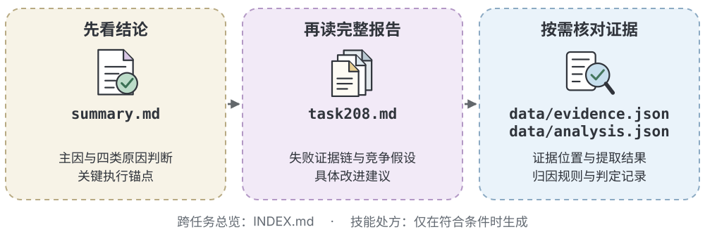

# 使用指南

**[English](../en/guide.md) | [简体中文](guide.md)** · [项目首页](../../README.zh.md) · [使用指南](guide.md)

<a id="case-failure-analyzer--系统工作流与归因总规范"></a>

**本页：** [安装与调用](#安装与调用) · [输入参数](#输入参数) · [默认行为与边界](#默认行为与边界) · [分析流程](#分析流程) · [归因约束](#归因约束) · [科学软件错误签名](#科学软件错误签名) · [开发与导出](#开发与导出) · [Harbor 定位与结果复核](#harbor-定位与结果复核)

本指南说明如何安装、调用和复核 `case-failure-analyzer`。智能体按 `SKILL.md` 组织取证与回答；Python 脚本负责提取证据、运行归因规则和生成报告。

## 安装与调用

### 安装到 Codex

需要 Python 3.9+。从本仓库根目录导出技能，运行时不需要安装第三方 Python 包：

```bash
python3 scripts/export_skill.py --dest "$HOME/.agents/skills/case-failure-analyzer"
```

导出内容为 `SKILL.md`、`agents/`、`scripts/` 和 `references/`。README、测试、文档页面和本地生成报告不随技能导出。脚本会拒绝将导出目标设为本仓库内部、仓库父目录或其他受保护位置。

| 使用范围 | 安装位置 | 说明 |
| --- | --- | --- |
| 当前用户的各个项目 | `~/.agents/skills/case-failure-analyzer/` | 上述命令使用此位置 |
| 指定基准仓库 | `<benchmark>/.agents/skills/case-failure-analyzer/` | 将 `--dest` 改为该路径；目标基准仓库应与本源码仓库分开 |
| 已有自定义技能目录 | 客户端实际发现的目录 | 导出到同一位置，避免同名技能的多个副本 |

本仓库的 `make export-skill` 默认使用 `$CODEX_HOME/skills/case-failure-analyzer`（未设置时为 `~/.codex/skills/case-failure-analyzer`）。按上面的示例显式指定 `--dest`，可以与当前 Codex 的用户级技能发现目录保持一致。Codex 会自动发现技能变更；若列表中未出现，再重启客户端。目录和触发规则见 [Codex 官方技能说明](https://learn.chatgpt.com/docs/build-skills#where-codex-loads-local-skills)。

### 在聊天中调用

推荐显式写出 `$case-failure-analyzer`，并提供任务引用和可访问的基准仓库路径。技能的显示名称为 `case failure analyzer`，实际标识为 `case-failure-analyzer`。

```text
$case-failure-analyzer 分析 task208，基准仓库是 /path/to/benchmark。
请用中文回答主根因、四类原因的判断依据，并给出完整报告链接。
```

只写任务编号时，默认选择匹配任务中修改时间最新的试次。锁定某次运行时，提供完整试次名：

```text
$case-failure-analyzer 分析试次 "task 208__jaekojA"，
基准仓库是 /path/to/benchmark。保留原始输入，输出中文归因报告。
```

也可以直接给作业和题目目录：

```text
使用 case-failure-analyzer 分析 /path/to/benchmark/jobs/run-001，
题目目录为 /path/to/benchmark/tasks/task208，
报告写入 /path/to/benchmark/failure-analysis/run-001。
```

智能体可根据自然语言请求匹配技能；显式点名便于确认使用哪个工作流。批量分析可以写：

```text
$case-failure-analyzer 分析 /path/to/benchmark 下的全部任务，
生成中文报告并更新 failure-report/INDEX.md。
```

任务 ID 模式会在聊天中给出归因摘要，并链接到 `failure-report/<task_id>/<task_id>.md`。报告文件和可选技能处方的条件见[报告规范](report-schema.md)。



### 更新与排查

更新源码后，重新执行同一条导出命令即可更新已管理文件。默认导出不删除目标目录中的其他文件；需要清理旧版本的已管理文件时，可以先用 `--clean --dry-run` 查看，再使用 `--clean`，清理范围受导出清单限制。

| 现象 | 检查位置 |
| --- | --- |
| 技能未出现 | 安装目录是否包含 `SKILL.md`、`scripts/` 和 `references/`；客户端是否已发现更新 |
| 同名技能重复 | 是否在用户目录和项目目录同时安装了相同技能 |
| 找不到任务 | 提供绝对基准路径；核对 `jobs/`、任务编号或完整试次名 |
| 能运行脚本但未按技能回答 | 在聊天中明确点名 `$case-failure-analyzer`，并要求返回归因摘要和报告链接 |
| `diff` 缺少证据 | 先生成审计报告；需要完整试次证据时在审计阶段使用 `--archive-evidence` |

<a id="输入参数-inputs"></a>

## 输入参数

需要或自动发现以下路径：

- `--job`：作业目录（`jobs/<job_name>` 或 `jobs_failed_backup/<job_name>`）或单个 Trial 目录
- `--task`：对应的任务定义目录（`tasks/<task_name>`，可省略并自动解析）

> **输入校验**：`--job` / `--task` 路径必须存在，`--trial` 必须在作业下真实存在，否则入口脚本以退出码 `2` 快速失败，不产出任何报告。仅当路径存在、无 Trial 目录但存在 job 级证据（`result.json` 或 `job.log`）时，才按“启动前 Job 级失败”继续分析。

<a id="默认行为与边界-default-behavior--boundaries"></a>

## 默认行为与边界

- **默认严格只读**：绝不修改 `tasks/`、`jobs/` 或 `tests/verify.py`。
- **确定性取证 + 模型因果推理**：确定性脚本负责生成客观 `evidence.json` 与候选假设 `candidate-hypotheses.json`；默认 `--phase all` 会输出保守的确定性草稿 `analysis.json`，可由 Agent/模型依据 [attribution-protocol.md](attribution-protocol.md) 覆盖式改写并核验。
- **证据优先归因**：严禁仅凭单一关键词直接定性根因；严格区分**直接失败现象 (`failure_manifestation`)**、**暴露阶段 (`detection_stage`)** 与**根本原因 (`primary_root_cause`)**。
- **指责 Agent 必须具备正面证据**：禁止采用“排除其他 Gate 后默认归因 Agent”的兜底逻辑。归因 `agent` 必须引用明确的正面证据（如 `behavioral_signals`、`agent_mismatch` 契约违约、或 Agent 操作引发的 `scientific_observations`）。
- **校准的不确定性**：当现有证据无法区分竞争假设时，诚实输出 `unknown` (`UNKNOWN_INSUFFICIENT_EVIDENCE`)。
- **中英双语报告产出**：默认生成合订本 `report.md`、纯中文版 `report.zh.md` 与纯英文版 `report.en.md`（当满足条件生成 `skill-prescription.md` 时同样包含双语对照）。

<a id="核心工作流-workflow"></a>

## 分析流程

### 1. 运行分析

使用统一 CLI（`scripts/cfa.py`）执行任务 ID 审计、只读脱敏检视与跨任务/跨试次对比，或对已知路径调用 `scripts/analyze_case.py`：

```bash
SKILL_DIR="$HOME/.agents/skills/case-failure-analyzer"
[ -d "$SKILL_DIR" ] || SKILL_DIR="${CODEX_HOME:-$HOME/.codex}/skills/case-failure-analyzer"
BENCH_ROOT="/path/to/benchmark"
python3 "$SKILL_DIR/scripts/cfa.py" audit task208 --jobs-root "$BENCH_ROOT" --lang zh
python3 "$SKILL_DIR/scripts/cfa.py" inspect task208 --jobs-root "$BENCH_ROOT" --section artifacts
python3 "$SKILL_DIR/scripts/cfa.py" inspect task208 --jobs-root "$BENCH_ROOT" --section step --step 43
python3 "$SKILL_DIR/scripts/cfa.py" diff task207 task208 --jobs-root "$BENCH_ROOT"
# 或按显式目录路径运行：
python3 "$SKILL_DIR/scripts/analyze_case.py" \
  --job "$BENCH_ROOT/jobs/run-001" \
  --task "$BENCH_ROOT/tasks/task208" \
  --output "$BENCH_ROOT/failure-analysis/run-001"
```

`cfa.py inspect` 支持 `--section verdict|report|errors|confidence|evidence|anchors|artifacts|step|data`（默认自动脱敏，支持 `--raw` 与 `--no-redact`）；`cfa.py diff <target_a> [<target_b>] [--trials <t1> <t2>]` 读取已有审计报告，对比两个任务或同一任务两个试次的裁决、主因、失败检查与因果锚点差异。自动选择的“最近两次”按 `trials/` 归档报告文件的修改时间排序；轻量归档缺少的证据不会自动补齐。

### 2. 确认运行阶段

脚本：`scripts/runtime_state.py` · `scripts/extract_runtime_errors.py`

基于单 Trial 证据判定 `agent_started`、`verifier_started`、`execution_status`、`verification_status` 与 `verdict`。若 `reward >= 1.0` 则直接判定为 `passed`，绝不因 Job 级汇总统计 `stats.n_errored_trials > 0` 误判通过的 Trial。

### 3. 重建轨迹与因果锚点

脚本：`scripts/normalize_trajectory.py` · `scripts/trace_causal_anchors.py`

将 `ATIF-v1.7`、`.jsonl` 及 OpenAI/Anthropic `tool_use`/`tool_result` 消息流跨步折叠标准化为时间线事件与行为信号（`behavioral_signals`），结合保留中段高显著性错误/指标行的截断策略与两阶段脚本输出目标图（`script_targets`）推断交付物写出路径（仍需核对已采集文件）；`trace_causal_anchors.py` 对关联失败产物的脚本执行/写入事件给予反向溯源加权，并提取关键科学参数的 `parameter_evolution` 演化轨迹。

### 4. 核对契约与交付物

脚本：`scripts/audit_contract.py`

比对 `Prompt <-> Verifier <-> Agent Output`，扫描 `artifacts/` 下的 JSON/CSV/TSV 交付物生成 `deliverable_diagnostics`（检测空表、`NaN`/`Inf` 数值与 `checked_keys` 缺失），并对 `tests/verify.py` 静态解析风险做因果绑定 (`failure_binding: direct | indirect | none`)，同时独立识别 Verifier 自身崩溃 (`verifier_internal_crash` / `VERIFIER_RECOMPUTE_DEFECT`)。

### 5. 提取科学错误

脚本：`scripts/extract_scientific_errors.py`

基于单一真值源 `references/error-families.json` 匹配 11 类科学计算与机器学习势套件的 60 类 `error_family`（支持 `.jsonl` 轨迹印证、不设数值偏差上限的具名指标配对，以及 `scale_or_sign_hint` 单位倍率/符号提示与 `stale_deliverable_sync` 待核实的未同步线索），并结合 `references/software/<software>.md` 判别证据要求。提示的触发条件、扫描限额和误读风险见[证据结构](evidence-schema.md#4-附加交叉核对交付物完整性与因果溯源扩展)。

### 6. 定位首次不可恢复偏离

记录 `{"status": "identified", "event_ref": "...", "summary": "..."}`；若因日志缺失无法定位，显式记录 `{"status": "not_identified", "event_ref": null, "summary": "..."}`。

### 7. 比较候选假设

脚本：`scripts/generate_hypotheses.py` · `scripts/confidence.py`

对候选假设（`H1`、`H2`...）列出支持证据 (`evidence_for`)、反对证据 (`evidence_against`)、缺失证据 (`missing_evidence`) 与反事实检验 (`counterfactual_test`)，并计算启发式证据强度评分 (`confidence_kind="heuristic_evidence_score"`，`evidence_strength="high|medium|low"`)。

### 8. 校验与生成报告

脚本：`scripts/validate_analysis.py` · `scripts/render_report.py`

通过 `validate_analysis.py` 强制校验 Schema、竞争假设、首次偏离点、Agent 正面证据及 4 个核心报告章节非空正文，最后输出 `report.md`、`report.zh.md`、`report.en.md` 及可选的 `skill-prescription.md`。

<a id="归因硬性约束-attribution-hard-rules"></a>

## 归因约束

1. **严禁仅凭单一关键词定根因**：日志中孤立出现 `chaotic` 等词汇而无轨迹/系综统计对比数据时，严禁判定为数值发散容差问题（无充分对比数据时必须归因 `unknown`）。
2. **严格区分失败现象、检测阶段与责任根因**。
3. **Agent 未启动硬规则 (`runtime.agent_started == false`)**：
   - 若 `agent_started == false` 且存在致命基础设施错误证据 → 必须归因 `infra`；
   - 若 `agent_started == false` 且没有任何异常或构建日志证据 → 必须归因 `unknown` (`UNKNOWN_INSUFFICIENT_EVIDENCE`)；
   - 若 `agent_started == false` → **绝对禁止**归因 `agent`。
4. **归因 `agent` 必须具备正面证据**：仅有 `reward=0` 或 `verify.log` 报错不构成 Agent 正面证据。
5. **静态解析 Hazard 必须完成因果绑定 (`failure_binding == "direct"`)**：若 `verify.log` 仅在参考值中打印 `1.23D+03` 而 Agent 实际输出了错误数值 `9.99E+02`，严禁误判为 Verifier 正则缺陷；反之，若 Verifier 因自身临时文件缺失（如 `FileNotFoundError: /tmp/verify_tmp/refs.json`）崩溃，必须归因 `verifier` (`VERIFIER_RECOMPUTE_DEFECT`)。
6. **证据不足或竞争假设无法区分时必须输出 `unknown`**。
7. **仅针对可复用的 Agent 科学/工程能力缺口生成 `skill-prescription.md`**：严禁为绕过 Infra 故障或 Verifier 缺陷而生成领域 Skill。

## 科学软件错误签名

注册表包含 11 组软件、60 类错误家族。这里列出的是日志匹配规则和判别证据指南，不代表对所列软件进行了完整兼容性验证。

| 套件 | 适用领域与软件 | 错误家族数 | 参考文档 |
| :--- | :--- | :---: | :--- |
| `cp2k` | 混合高斯/平面波 DFT 与从头算分子动力学 (`CP2K`) | 8 | [cp2k.md](../../references/software/cp2k.md) |
| `quantum-espresso` | 平面波 DFT / DFPT (`pw.x`, `bands.x`, `dos.x`, `ph.x`) | 6 | [quantum-espresso.md](../../references/software/quantum-espresso.md) |
| `vasp-abacus` | 固态平面波与局域基 DFT (`VASP`, `ABACUS`, `GPAW`, `Siesta`, `FHI-aims`) | 5 | [vasp-abacus.md](../../references/software/vasp-abacus.md) |
| `orca-gaussian-pyscf` | 分子量子化学 (`ORCA`, `Gaussian`, `PySCF`, `Psi4`, `Q-Chem`, `NWChem`) | 5 | [orca-gaussian-pyscf.md](../../references/software/orca-gaussian-pyscf.md) |
| `lammps` | 经典与反应力场分子动力学 (`LAMMPS`) | 8 | [lammps.md](../../references/software/lammps.md) |
| `gromacs-amber-openmm` | 生物分子动力学 (`GROMACS`, `AMBER`, `OpenMM`, `NAMD`, `CHARMM`) | 4 | [gromacs-amber-openmm.md](../../references/software/gromacs-amber-openmm.md) |
| `mlip` | 机器学习原子间势 (`MACE`, `NequIP`, `Allegro`, `DeePMD-kit`, `CHGNet`, `SevenNet`, `Orb`) | 5 | [mlip.md](../../references/software/mlip.md) |
| `ase` | 原子模拟工作流与计算器 (`ASE`, `pymatgen`) | 5 | [ase.md](../../references/software/ase.md) |
| `xtb` | 半经验量子化学与构象搜索 (`xTB`, `CREST`) | 5 | [xtb.md](../../references/software/xtb.md) |
| `rdkit` | 化学信息学与构象生成 (`RDKit`) | 5 | [rdkit.md](../../references/software/rdkit.md) |
| `generic-scientific` | 数值求解器与偏微分方程 (`SciPy`, `NumPy`, `JAX`, `PyTorch`, `FEniCS`, `OpenFOAM`) | 4 | [generic-scientific.md](../../references/software/generic-scientific.md) |

## Harbor 定位与结果复核

任务编号模式先匹配常见 Harbor 目录，再在未命中时进行有深度限制、跳过重型目录的搜索。支持平铺的 `jobs/<job>/task208__<trial>` 和按套件组织的 `<suite>/jobs/<job>/task208__<trial>`；题目定义可放在套件根目录或 `tasks/` 下。同号任务优先绑定所选试次所在套件的定义；仍有多个候选时会报错，不按目录字母序猜测。

分析会读取 job/trial 的 `result.json` 与日志、`agent/trajectory.json` 或可识别的 JSONL 轨迹、`verifier/` 判定、题目说明和验证脚本，并检查 `task.toml` 声明路径在 `artifacts/` 下的采集结果。数字任务编号是本项目的快捷约定；任意名称任务可通过 `--job`、`--task` 和 `--output` 显式指定。

### 支持范围

- 当前交付路径提取支持 `task.toml` 中的字符串或字符串数组。带 `source` / `service` 的对象声明尚未完整适配，不能把未提取到路径解释成已验证交付完整。
- 数值核对主要处理 JSON/CSV/TSV 和可识别日志。文件扫描、字节数和轨迹读取均有限额，不是对任意二进制科学产物的完整验证。
- 分析读取本地已保存记录，不会自动下载 Harbor Hub 作业，也不执行独立科学复算。规则分数表示证据强度，不是根因正确的概率。

### 复核顺序

1. 核对试次与题目路径。默认“最新”取修改时间，必要时使用完整试次名，避免把另一轮运行的产物混入分析。
2. 检查 `diagnostics`、`missing_deliverables` 和具名失败检查，先确认哪些证据缺失或解析失败。`result.json` 是运行器记录，不等同于智能体提交的计算结果。
3. 从报告的证据引用回到原始文件、工具调用和输出，检查单位、字段对应关系以及执行先后顺序；静态提示需要实证支持。
4. 运行结构与约束校验。以下命令针对任务 ID 模式，`REPORT_DIR` 应为实际报告目录：

```bash
python3 "$SKILL_DIR/scripts/validate_analysis.py" \
  --evidence "$REPORT_DIR/data/evidence.json" \
  --analysis "$REPORT_DIR/data/analysis.json" \
  --report "$REPORT_DIR/task208.md"
```

校验会检查字段、证据标识、归因约束和报告章节，但不能证明物理结论或因果判断必然正确。科学结论仍需在适当环境中独立复算或由领域人员复核；证据不足时保留 `unknown`。

## 开发与导出

| 文件或目录 | 用途 | 随技能导出 |
| --- | --- | --- |
| `SKILL.md` | 智能体执行流程与回答要求 | 是 |
| `agents/openai.yaml` | Codex 显示名称、简介和默认提示词 | 是 |
| `scripts/` | 分析、校验、报告生成与导出脚本 | 是 |
| `references/` | 归因协议、字段定义与软件规则 | 是 |
| `docs/`、`README*` | 面向读者的说明与配图 | 否 |
| `tests/`、`Makefile` | 测试夹具与开发命令 | 否 |
| `pyproject.toml` | Python 版本、开发依赖、Ruff 与 pytest 配置 | 否 |

直接运行分析脚本不需要安装开发依赖。`agents/openai.yaml` 提供技能界面配置；`pyproject.toml` 服务于仓库开发与检查，两者用途不同。

```bash
make compile       # Python 语法检查
make test          # 标准库 unittest
make check-docs    # 英文文档镜像及指南语言链接检查
make smoke         # 内置两试次夹具
make check         # lint、测试、文档与格式检查（需要 ruff）
make export-skill DEST=/path/to/skills/case-failure-analyzer
```
