# 根因分类（`failure-analysis-v1`）

**[English](../en/taxonomy.md) | [简体中文](taxonomy.md)** · [项目首页](../../README.zh.md) · [使用指南](guide.md)

**本页：** [执行与检出阶段](#1-执行与检出阶段) · [四类并列根因](#2-四类并列根因) · [Harbor 验证前运行器故障](#3-harbor-验证前运行器故障)

本文定义四类根因及其子类。每份 `analysis.json` 记录 `failure_stage`、`detection_stage` 和 `primary_root_cause`（`category`、`subtype`、`code`）。

## 1. 执行与检出阶段

| 阶段标识 | 说明 |
|---|---|
| `environment_build` | 容器启动前的镜像拉取、`Dockerfile` 构建或 `docker compose build` |
| `environment_runtime` | 容器启动、卷挂载或运行时守护进程执行 |
| `agent_setup` | 在容器内安装或初始化智能体程序（`claude-code`、MCP、环境变量） |
| `agent_execution` | 智能体推理、工具调用、科学模拟与结果生成 |
| `verifier_execution` | 执行 `tests/test.sh` 和 `tests/verify.py` |
| `runner` | 宿主运行器（`harbor`）的调度与生命周期管理 |

## 2. 四类并列根因

主根因从四个并列类别中选择，分别对应科学基准测试中的不同失败来源。

```mermaid
flowchart TD
    Root["基准评测失败归因"]
    
    Root --> C1["1. 智能体决策与执行失误\n(agent)"]
    Root --> C2["2. 基准题目与规格设计缺陷\n(case)"]
    Root --> C3["3. 运行环境与依赖设施缺陷\n(infra)"]
    Root --> C4["4. 评测验证与规则判定缺陷\n(verifier)"]

    C1 --> C11["科学方法选型 (scientific_method_selection)"]
    C1 --> C12["科学参数设定 (scientific_parameter_selection)"]
    C1 --> C13["任务与契约理解 (task_understanding)"]
    C1 --> C14["工作流规划 (planning)"]
    C1 --> C15["代码与工具调用 (tool_use)"]
    C1 --> C16["结果校验归一化 (result_validation)"]
    C1 --> C17["自检覆盖不足 (self_check_gap)"]

    C2 --> C21["题干约定缺失/歧义 (ambiguous_contract)"]
    C2 --> C22["初始资产缺失/损坏 (missing/corrupt_asset)"]
    C2 --> C23["参考真值矛盾 (prompt_ref_mismatch)"]
    C2 --> C24["算力与耗时预算不足 (insufficient_timeout)"]

    C3 --> C31["容器镜像与运行时崩溃 (container_build/runtime)"]
    C3 --> C32["外部网络通信异常 (external_network)"]
    C3 --> C33["LLM API 网关与限流 (api_error/api_rate_limit)"]
    C3 --> C34["资源耗尽与生命周期中断 (oom/disk/runner_lifecycle)"]

    C4 --> C41["验证器超紧容差碰撞 (tolerance_too_strict)"]
    C4 --> C42["验证器强类型不兼容 (schema_mismatch)"]
    C4 --> C43["正则与文本解析缺陷 (regex_or_parser_defect)"]
    C4 --> C44["隐藏未声明私有契约 (hidden_contract)"]
    C4 --> C45["验证器自身脚本崩溃 (recompute_defect)"]
```

展开子类关系图

### 2.1 智能体决策与执行失误 (`agent`)

**责任主体**：被评测的大模型智能体。当题目规格、运行环境与验证器均正常时，智能体发生未自愈的科学决策、工程规划或代码编写错误。

| 编码与子类 | 含义与示例 |
| --- | --- |
| `AGENT_SCIENTIFIC_METHOD_SELECTION` `scientific_method_selection` | **科学方法与理论模型选型失误**。理论模型、泛函基组、力场、系综或自洽场求解器选型错误（如未识别自由基为开壳层，未开启自旋极化 LSD/UKS） |
| `AGENT_SCIENTIFIC_PARAMETER_SELECTION` `scientific_parameter_selection` | **科学参数与收敛截断配置失误**。积分时间步长超出稳定性上限（如 LJ 流体步长 > 0.006）、微分步长过大、k点网格移位偏差、截断能未收敛 |
| `AGENT_TASK_UNDERSTANDING` `task_understanding` | **任务契约与物理量定义理解偏差**。对题干物理量概念或数学范数理解偏差（如混淆受力分量极值 L_inf 与原子合力向量模长 L2）、拟合区间对齐错误 |
| `AGENT_PLANNING` `planning` | **工作流编排与上下文状态保持失误**。多阶段计算次序错乱、未冻结前序构型资产（误触发弛豫）、未正确关联前序输出目录（`outdir`/`prefix`） |
| `AGENT_TOOL_USE` `tool_use` | **工具调用与脚本生成缺陷**。自动化生成输入文件或解析脚本时出现语法错误、遗漏关键晶胞参数（如 `celldm(1)`）或写错文件 |
| `AGENT_RESULT_VALIDATION` `result_validation` | **结果后处理与数据核验失误**。量纲单位转换除错、每原子归一化因子除错、衍生量未核验物理自洽性即写入 `results.json` |
| `AGENT_SELF_CHECK_GAP` `self_check_gap` | 自检实际运行，漏过了一项公开要求，提交随后因这项要求遭拒。例如，`verify_outputs.py` 检查了内部一致性，却未复算 `spin_selection` 或 `energy_parameters`。 |
| `AGENT_PATH_OR_DEPENDENCY_DISCOVERY` `path_or_dependency_discovery` | **环境依赖与资产寻址失败**。未能在容器已知路径中定位已预装的二进制、赝势文件、力场参数文件或 Checkpoint |
| `AGENT_ERROR_DIAGNOSIS` `error_diagnosis` | **物理报错诊断失误**。仿真软件已给出明确报错诊断，智能体误判物理诱因并进行无效修改 |
| `AGENT_RECOVERY` `recovery` | **自愈恢复策略失效**。面对错误盲目重复执行完全相同的失败命令，或陷入重试死循环 |
| `AGENT_PREMATURE_TERMINATION` `premature_termination` | **任务过早终止**。在关键模拟未收敛或产物未交付前主动停止规划 |

### 2.2 基准题目与规格设计缺陷 (`case`)

**责任主体**：基准出题人与指令规范。评测题目的 prompt 说明、先验假设、初始资产或参考真值本身存在不完备、歧义或物理冲突。

| 编码与子类 | 含义与示例 |
| --- | --- |
| `CASE_AMBIGUOUS_CONTRACT` `ambiguous_contract` | **题干约定缺失或语义歧义**。题干未指明双向符号约定（如漂移率正负号定义）、未指明生产相采样步数、未在 Fixed Conditions 中固化仿真微调参数（如 neighbor_modify 导致重启发散）、算法严格/宽松定义分歧（如 RDKit 可旋转键数计算） |
| `CASE_MISSING_ASSET` `missing_asset` | **初始资产文件缺失**。题干引用的输入结构、赝势或参数文件在容器中实际不存在 |
| `CASE_CORRUPT_ASSET` `corrupt_asset` | **初始物料数据损坏**。提供的输入结构存在非物理重叠或格式损坏，且非题目故意考察的排障点 |
| `CASE_PROMPT_REF_MISMATCH` `prompt_ref_mismatch` | **参考真值与题干要求矛盾**。`refs.json` 中标定的真值采用的计算方法或参数与题干要求的条件不一致 |
| `CASE_INSUFFICIENT_TIMEOUT` `insufficient_timeout` | **超时预算或算力配额不合理**。任务所需科学计算量在标准 CPU 配额下理论无法在限时内完成 |

### 2.3 运行环境与依赖设施缺陷 (`infra`)

**责任主体**：底层运行平台与执行基础设施。与题目逻辑及判分代码独立，属于软硬件支撑层。

| 编码与子类 | 含义与示例 |
| --- | --- |
| `INFRA_CONTAINER_BUILD` `container_build` | **容器镜像构建失败**。Docker 镜像拉取或 `Dockerfile` 构建命令执行失败 |
| `INFRA_CONTAINER_RUNTIME` `container_runtime` | **容器运行时异常**。容器意外崩溃、后台守护进程挂死或挂载失效 |
| `INFRA_EXTERNAL_NETWORK` `external_network` | **外部网络通信异常**。构建或初始化阶段 `apt`、`pip`、外部模型拉取因网络阻断失败 |
| `INFRA_API_ERROR` `api_error` | **LLM API 网关异常**。LLM Gateway 代理返回 HTTP 5xx/502/504 或连接重置 |
| `INFRA_API_RATE_LIMIT` `api_rate_limit` | 模型服务因限流或配额耗尽中断请求。确认中断需要本试次的终止记录，例如 HTTP 429 后 SDK 终止执行。已恢复的请求单独记录。 |
| `INFRA_OOM` `oom` | **内存溢出**。容器或计算进程触发 OOM Killer (`SIGKILL` / exit 137) |
| `INFRA_DISK` `disk` | **磁盘空间耗尽**。容器存储配额耗尽 (`No space left on device`) |
| `INFRA_AGENT_TIMEOUT` `agent_timeout` | **智能体执行超时**。智能体推理与工具交互超出总时限门禁 |
| `INFRA_RUNNER_LIFECYCLE` `runner_lifecycle` | **评测宿主调度异常**。评测框架调度死锁、强制取消或 Runner 宿主崩溃 |
| `INFRA_VERIFIER_INTERPRETER_MISSING` `verifier_interpreter_missing` | **评分解释器缺失。** 评分入口未能启动所调用的 Python，且没有有效分数。 |
| `INFRA_AGENT_AUTOCOMPACT_THRASHING` `autocompact_thrashing` | **上下文压缩循环终止。** harness 明确记录终止原因；不以早先可恢复的 API 提示代替。 |
| `INFRA_AGENT_OUTPUT_TOKEN_LIMIT` `output_token_limit` | **输出上限终止。** 终止记录明确指向输出 token 限制，与科学结果问题分别分析。 |

### 2.4 评测验证与规则判定缺陷 (`verifier`)

**责任主体**：评测验证脚本（`verify.py`、`test.sh`）、评分规则或评分依赖。定位到验证器缺陷，不等于已经证明提交的科学结果正确或整个任务应通过。

| 编码与子类 | 含义与示例 |
| --- | --- |
| `VERIFIER_TOLERANCE_TOO_STRICT` `tolerance_too_strict` | **验证器容差过于苛刻**。能量/受力容差远小于数值/物理平台噪声或化学有效精度（如微电子伏级 1 µeV 超紧容差碰撞），导致物理正确但判定为 0 |
| `VERIFIER_SCHEMA_MISMATCH` `schema_mismatch` | **验证器强类型比较不兼容**。验证器执行脆弱的强类型断言比对（如硬编码 `isinstance(..., int)` 拒绝字符串整数 `"100"`，`"12"`），未做宽容类型转换 |
| `VERIFIER_REGEX_OR_PARSER_DEFECT` `regex_or_parser_defect` | **验证器文本解析与正则缺陷**。验证器正则未过滤 LAMMPS run 0 打印的重复表头、无法解析科学记数法（如 Fortran `D+03`）或多行输出 |
| `VERIFIER_HIDDEN_CONTRACT` `hidden_contract` | **验证器隐藏未公开私有契约**。验证器校验了题干从未声明的内部中间文件、特定列顺序或非标私有字段 |
| `VERIFIER_RECOMPUTE_DEFECT` `recompute_defect` | **验证器自身重算崩溃**。验证器独立重算脚本因自身临时目录配置缺失、路径未转义或缺失环境依赖而抛出异常崩溃 |
| `VERIFIER_TRUSTED_ASSET_HASH_MISMATCH` `trusted_asset_hash_mismatch` | **可信评分资料哈希不一致。** 与实际评分拒绝直接关联，不通过跳过校验处理。 |
| `VERIFIER_REFERENCE_LFS_POINTER` `reference_lfs_pointer` | **评分依赖文件仍为 LFS 指针。** 核对评分器读取或哈希校验失败时点名的文件，以及本地指针的内容。历史运行读取的文件版本仍可能需要确认。 |

### 2.5 辅助类别：未知与证据缺失 (`unknown`)

仅当运行产物严重缺失，无法建立确定性因果链时使用。

| 编码 | 子类 | 说明 |
|---|---|---|
| `UNKNOWN_INSUFFICIENT_EVIDENCE` | `insufficient_evidence` | 关键日志缺失、无执行轨迹，或竞争假设证据置信度无法区分 |

## 3. Harbor 验证前运行器故障

Harbor 在 Agent 执行之后、验证之前，用 `docker cp` 采集已声明交付物（`task.toml` → `artifacts`）。发生在该窗口内的失败为 `failure_stage: "runner"`、`detection_stage: "runner"`，且当验证器从未启动时裁定为 `errored`。它们**不是** `environment_build` / `container_build` 失败，也**不是** Agent 的“过早终止”裁定。

| 编码 | 子类 | 说明 |
|---|---|---|
| `INFRA_ARTIFACT_COLLECTION_CRASH` | `artifact_collection_crash` | `RuntimeError: Engine cp failed ('<container>:/app/final' ...): Could not find the file /app/final in container ...` —— 已声明路径缺失，Runner 中止整个 Trial |
| `INFRA_RUNNER_INTERRUPTED` | `runner_interrupted` | Runner 日志止于 `Collecting main service artifacts`，既无验证器输出也无完成记录（静默中断） |
| `INFRA_AGENT_TIMEOUT` | `agent_timeout` | 来自 `exception_info` / `trial.log` 的 `AgentTimeoutError`。Harbor 在已声明交付物完成前终止了 Agent；短时限属于基础设施 / 作业配置故障，而非 Agent 决策 |
| `AGENT_MISSING_DECLARED_DELIVERABLE` | `deliverable_not_written` | **伴随因素**（非主根因）：Agent 未在容器内留下某个已声明交付物。Gate 1c 将其显式保留，而 Runner 侧故障仍为主根因 |

**验证前窗口内的因果优先级：** 作为因果项的 `INFRA_AGENT_TIMEOUT` 优先于下游的 `INFRA_ARTIFACT_COLLECTION_CRASH`，因为 Agent 在来得及写出这些路径之前就已被停止；采集崩溃随后记为伴随因素。若验证器确已启动（例如超时但 Trial 仍评分 `reward=0`），裁定仍为 `failed` 且 `detection_stage: verifier_execution`，但主根因依旧是 `infra`。

**三态裁定：** `passed` 与已评分的 `failed` 属于*已评分*状态；在该窗口内中止的 Trial 属于*未评分*（`reward=None`、`verifier_started == false`）。批次看板必须同时给出总体通过率（`passed / total`）与已评分通过率（`passed / (passed + scored_failed)`）；未评分 Trial 绝不能被计为 Agent 失败。

## 4. 表示与契约复核标签

`Verifier / Case contract mismatch` 是跨 case/verifier 的复核标签，不新增第五个根因大类。其下区分：`semantic_rejection`（语义误拒）、`hidden_format_requirement`（未公开格式要求）和 `definition_ambiguity`（定义歧义）。静态发现必须绑定实际拒绝规则、提交表示和公开材料；只作为待复核线索，不自动宣判 verifier 有错或把失败改成通过。

数学上不同的量（如力分量最大值与每原子力向量范数最大值）、公开要求下仍未完成的核验、以及重放脚本漏生成产物，应分别检查，不能统一解释为“格式过严”。

## Agent 能力诊断维度

对主根因为 `agent` 的失败试次，沿实际输入、输出或报告找到能解释本次失败的具体决策。一个受审决策选一个主维度。后续自检若有独立的动作和证据，可作为伴随因素记录。现有根因代码用于描述失败机制，能力维度用于比较不同任务中的决策。

| 维度 | 判定依据与边界 |
|---|---|
| `observable_definition` 科学问题与物理量定义 | 对照公开定义与采用的公式、参考态或停止量。例如用最大受力分量替代逐原子受力模长最大值，会改变用于收敛判断的物理量。 |
| `physical_model` 体系构建与物理建模 | 从有效输入或实际公式定位组成、电荷、自旋、相互作用、边界条件或物理近似的改变，核对任务允许的模型。 |
| `numerical_adequacy` 数值收敛与采样充分性 | 固定模型和目标量，查所选网格、截断、时间步长、收敛准则或采样方案如何影响精度。要辨别参数由谁选定，并查明对目标量的后果。 |
| `workflow_state` 工作流编排与状态传递 | 查前一步生成什么、下一步实际读到什么，以及作业状态或目录如何关联。先核对公开任务对原始交付和隔离重放分别有何要求。 |
| `execution_recovery` 软件执行与故障恢复 | 指出 Agent 控制的进程、报错后的动作和后续结果。核对重试时的输入是否改变、先前异常是否已经恢复。 |
| `postprocessing_provenance` 后处理与结果溯源 | 当目标量已定义，沿原始列、引用、换算和聚合语句追到提交字段。例如能量计算完成后，将相对偏移量写入逐态能量栏。 |
| `independent_validation` 独立验证与自检 | 定位实际执行的自检准则或按目标值选择验证数据的行为，将覆盖范围与公开要求、漏过的缺陷相对照。注明检查对象是格式契约、科学有效性还是证据独立性。 |
| `conclusion_calibration` 科学结论与不确定性判断 | 对照证据可识别的范围与实际声明。包括从不同计算阶段的网格断言未收敛，以及推断不确定性时擅自缩小允许的协方差集合。 |

遇到同一个错误数值，分别检查对物理量的定义、数值近似和写入结果的过程。公开要求含糊时，评分器采用的特定约定只能用于解释评分行为。保留这种竞争解释并记录缺失材料。[能力审查](evidence-review.md#能力判断) · [CompChemWorld 试标记录](agent-capability-pilot.md)
