# Failure Taxonomy (`failure-analysis-v1`)

**On this page:** [Execution & Detection Stages](#1-execution--detection-stages) · [Root-cause categories](#2-four-peer-root-cause-categories) · [Harbor runner codes](#3-harbor-runner-stage-codes-post-agent--pre-verifier)

This document defines the standardized, peer-level classification hierarchy for `case-failure-analyzer`. Every `analysis.json` assigns a `failure_stage`, a `detection_stage`, and a `primary_root_cause` (`category`, `subtype`, `code`).

## 1. Execution & Detection Stages

| Stage ID | Description |
|---|---|
| `environment_build` | Docker image pull, `Dockerfile` build, or `docker compose build` before container start |
| `environment_runtime` | Container startup, volume mounting, or runtime daemon execution |
| `agent_setup` | Installing/initializing the agent binary (`claude-code`, MCP, env vars) inside the container |
| `agent_execution` | Agent reasoning, tool calls, scientific simulation execution, and result generation |
| `verifier_execution` | Execution of `tests/test.sh` and `tests/verify.py` |
| `runner` | Host benchmark runner (`harbor`) orchestration and lifecycle management |

## 2. Four peer root-cause categories

Failure attribution is structured into four mutually exclusive, peer-level systemic categories, each representing an independent source of failure in scientific benchmark evaluations.

```mermaid
flowchart TD
    Root["Failure attribution"]
    
    Root --> C1["Agent"]
    Root --> C2["Task"]
    Root --> C3["Infrastructure"]
    Root --> C4["Verifier"]

    C1 --> C11["scientific_method_selection"]
    C1 --> C12["scientific_parameter_selection"]
    C1 --> C13["task_understanding"]
    C1 --> C14["planning"]
    C1 --> C15["tool_use"]
    C1 --> C16["result_validation"]
    C1 --> C17["self_check_gap"]

    C2 --> C21["ambiguous_contract"]
    C2 --> C22["missing/corrupt_asset"]
    C2 --> C23["prompt_ref_mismatch"]
    C2 --> C24["insufficient_timeout"]

    C3 --> C31["container_build/runtime"]
    C3 --> C32["external_network"]
    C3 --> C33["api_error/api_rate_limit"]
    C3 --> C34["oom/disk/runner_lifecycle"]

    C4 --> C41["tolerance_too_strict"]
    C4 --> C42["schema_mismatch"]
    C4 --> C43["regex_or_parser_defect"]
    C4 --> C44["hidden_contract"]
    C4 --> C45["recompute_defect"]
```

Expand the subtype map

### 2.1 Agent decisions and execution (`agent`)

The evaluated agent makes an unrecovered scientific, planning, or coding error while the task specification, environment, and verifier are functioning correctly.

| Code and subtype | Meaning and examples |
| --- | --- |
| `AGENT_SCIENTIFIC_METHOD_SELECTION` `scientific_method_selection` | **Scientific method and model selection.** Wrong theoretical model, functional/basis, force field, ensemble, or SCF solver; for example, treating a radical as closed-shell without LSD/UKS spin polarization. |
| `AGENT_SCIENTIFIC_PARAMETER_SELECTION` `scientific_parameter_selection` | **Scientific parameters and convergence settings.** An unstable integration time step (e.g. an LJ-fluid step > 0.006), excessive finite-difference step, shifted k-point grid, or unconverged energy cutoff. |
| `AGENT_TASK_UNDERSTANDING` `task_understanding` | **Task contract and physical quantity interpretation.** Misreading a physical quantity or mathematical norm, such as force-component L_inf versus per-atom vector L2, or misaligning a fitting interval. |
| `AGENT_PLANNING` `planning` | **Workflow sequencing and state management.** Incorrect order of calculation stages, failure to freeze an earlier geometry (triggering unintended relaxation), or incorrect links to prior outputs (`outdir`/`prefix`). |
| `AGENT_TOOL_USE` `tool_use` | **Tool calls and generated scripts.** Syntax errors in generated inputs or parsers, missing cell parameters such as `celldm(1)`, or writing the wrong file. |
| `AGENT_RESULT_VALIDATION` `result_validation` | **Post-processing and result validation.** Incorrect unit conversion or per-atom normalization, or writing derived quantities to `results.json` without checking physical consistency. |
| `AGENT_SELF_CHECK_GAP` `self_check_gap` | An executed self-check missed a public requirement tied to the rejection. For example, `verify_outputs.py` checked internal consistency but omitted the required recomputation of `spin_selection` or `energy_parameters`. |
| `AGENT_PATH_OR_DEPENDENCY_DISCOVERY` `path_or_dependency_discovery` | **Path and dependency discovery.** Failure to locate preinstalled binaries, pseudopotentials, force-field parameters, or checkpoints in known container paths. |
| `AGENT_ERROR_DIAGNOSIS` `error_diagnosis` | **Scientific error diagnosis.** The simulator provides an explicit diagnostic, but the agent misidentifies its physical cause and makes ineffective changes. |
| `AGENT_RECOVERY` `recovery` | **Recovery strategy.** Repeating the same failed command without changes, or entering an unproductive retry loop. |
| `AGENT_PREMATURE_TERMINATION` `premature_termination` | **Premature termination.** Stopping planning before a required simulation has converged or the required artifacts have been delivered. |

### 2.2 Task design (`case`)

The task author or specification supplies incomplete, ambiguous, or physically conflicting instructions, assumptions, input assets, or reference values.

| Code and subtype | Meaning and examples |
| --- | --- |
| `CASE_AMBIGUOUS_CONTRACT` `ambiguous_contract` | **Missing or ambiguous task conventions.** Unspecified bidirectional sign conventions (e.g. drift-rate sign), production sampling steps, or simulation adjustments under Fixed Conditions (e.g. neighbor_modify causing restart divergence); conflicting strict/loose algorithm definitions such as RDKit rotatable-bond counts. |
| `CASE_MISSING_ASSET` `missing_asset` | **Missing input assets.** An input structure, pseudopotential, or parameter file referenced by the task is absent from the container. |
| `CASE_CORRUPT_ASSET` `corrupt_asset` | **Corrupt input assets.** A supplied input structure has unphysical overlaps or malformed data, outside the task's intended troubleshooting scope. |
| `CASE_PROMPT_REF_MISMATCH` `prompt_ref_mismatch` | **Reference and task mismatch.** The reference values in `refs.json` use methods or conditions inconsistent with the task specification. |
| `CASE_INSUFFICIENT_TIMEOUT` `insufficient_timeout` | **Insufficient time or compute budget.** The required scientific computation cannot theoretically finish within the time limit under the standard CPU allocation. |

### 2.3 Runtime infrastructure (`infra`)

The failure belongs to the underlying runtime platform or execution infrastructure, independently of task logic and scoring code.

| Code and subtype | Meaning and examples |
| --- | --- |
| `INFRA_CONTAINER_BUILD` `container_build` | **Container image build.** Docker image pull or `Dockerfile` build command failure. |
| `INFRA_CONTAINER_RUNTIME` `container_runtime` | **Container runtime.** Unexpected container crash, hung background daemon, or failed mount. |
| `INFRA_EXTERNAL_NETWORK` `external_network` | **External network.** Network restrictions prevent `apt`, `pip`, or external model downloads during build or initialization. |
| `INFRA_API_ERROR` `api_error` | **LLM API gateway.** The LLM gateway returns HTTP 5xx/502/504 or resets the connection. |
| `INFRA_API_RATE_LIMIT` `api_rate_limit` | The model service cut off requests at a rate or usage limit. Look for a terminal record from the trial, such as an HTTP 429 followed by SDK termination. A recovered request can be recorded separately. |
| `INFRA_OOM` `oom` | **Out of memory.** The container or calculation process triggers the OOM killer (`SIGKILL` / exit 137). |
| `INFRA_DISK` `disk` | **Disk exhaustion.** The container exhausts its storage allocation (`No space left on device`). |
| `INFRA_AGENT_TIMEOUT` `agent_timeout` | **Agent timeout.** Agent reasoning and tool interactions exceed the total time budget. |
| `INFRA_RUNNER_LIFECYCLE` `runner_lifecycle` | **Runner lifecycle.** Benchmark scheduler deadlock, forced cancellation, or runner-host crash. |
| `INFRA_VERIFIER_INTERPRETER_MISSING` `verifier_interpreter_missing` | **Missing scoring interpreter.** The scoring entrypoint could not launch its Python interpreter and produced no valid score. |
| `INFRA_AGENT_AUTOCOMPACT_THRASHING` `autocompact_thrashing` | **Terminal compaction loop.** The harness identifies this as the terminal cause; earlier recovered API notices are not substituted for it. |
| `INFRA_AGENT_OUTPUT_TOKEN_LIMIT` `output_token_limit` | **Terminal output limit.** The recorded exit identifies an output-token limit; scientific output defects are assessed separately. |

### 2.4 Verifier rules and scoring (`verifier`)

The verification scripts (`verify.py`, `test.sh`), scoring rules, or scoring dependencies are defective. A bound verifier fault does not by itself establish that the submitted scientific result is correct or that the whole task should pass.

| Code and subtype | Meaning and examples |
| --- | --- |
| `VERIFIER_TOLERANCE_TOO_STRICT` `tolerance_too_strict` | **Overly strict tolerance.** Energy/force tolerances are far below numerical or physical noise or chemically meaningful precision, such as a 1 µeV tolerance rejecting a physically correct result with score 0. |
| `VERIFIER_SCHEMA_MISMATCH` `schema_mismatch` | **Incompatible type checks.** Brittle type assertions, such as `isinstance(..., int)`, reject string integers `"100"` or `"12"` without conversion. |
| `VERIFIER_REGEX_OR_PARSER_DEFECT` `regex_or_parser_defect` | **Text parsing and regular expressions.** The parser fails to filter repeated LAMMPS run 0 headers or to handle scientific notation such as Fortran `D+03` or multiline output. |
| `VERIFIER_HIDDEN_CONTRACT` `hidden_contract` | **Undisclosed private contract.** The verifier checks intermediate files, column order, or private fields never declared in the task. |
| `VERIFIER_RECOMPUTE_DEFECT` `recompute_defect` | **Verifier recomputation crash.** Independent recomputation crashes because of missing temporary-directory configuration, unescaped paths, or missing environment dependencies. |
| `VERIFIER_TRUSTED_ASSET_HASH_MISMATCH` `trusted_asset_hash_mismatch` | **Trusted scoring asset hash mismatch.** Bound to an actual scoring rejection; do not resolve it by bypassing validation. |
| `VERIFIER_REFERENCE_LFS_POINTER` `reference_lfs_pointer` | **Packaged scoring input is an LFS pointer.** Match the input named in a saved read or hash failure to a local pointer. Historical file identity may still need review. |

### 2.5 Insufficient evidence (`unknown`)

Use when severe gaps in run artifacts prevent establishing a causal chain.

| Code | Subtype | Meaning |
|---|---|---|
| `UNKNOWN_INSUFFICIENT_EVIDENCE` | `insufficient_evidence` | Missing key logs or execution traces, or evidence scores that cannot distinguish competing hypotheses |

## 3. Harbor Runner-Stage Codes (Post-Agent / Pre-Verifier)

Harbor collects the declared deliverables (`task.toml` → `artifacts`) with `docker cp` after agent execution and before verification. Failures in this window are `failure_stage: "runner"`, `detection_stage: "runner"`, verdict `errored` when the verifier never started. They are **not** `environment_build` / `container_build` failures and **not** agent "premature termination" verdicts.

| Code | Subtype | Meaning |
|---|---|---|
| `INFRA_ARTIFACT_COLLECTION_CRASH` | `artifact_collection_crash` | `RuntimeError: Engine cp failed ('<container>:/app/final' ...): Could not find the file /app/final in container ...` — declared path missing, runner aborts the whole trial |
| `INFRA_RUNNER_INTERRUPTED` | `runner_interrupted` | Runner log ends at `Collecting main service artifacts` with no verifier output or completion record (silent interruption) |
| `INFRA_AGENT_TIMEOUT` | `agent_timeout` | `AgentTimeoutError` from `exception_info` / `trial.log`. Harbor killed the agent before declared deliverables were complete; a short timeout is an infra / job-configuration fault, not an agent decision |
| `AGENT_MISSING_DECLARED_DELIVERABLE` | `deliverable_not_written` | **Contributing factor** (not primary): the agent did not leave a declared deliverable in the container. Gate 1c keeps this explicit while the runner-side fault stays primary |

**Causal priority inside the pre-verification window:** a causal `INFRA_AGENT_TIMEOUT` outranks a downstream `INFRA_ARTIFACT_COLLECTION_CRASH`, because the agent was stopped before it could write the paths. The collection crash is then recorded as a contributing factor. When the verifier did start (e.g. a timeout whose trial still scored `reward=0`), the verdict stays `failed` with `detection_stage: verifier_execution`, but the primary root cause remains `infra`.

**Three-state verdicts:** `passed` and scored `failed` are *scored* states; trials that died in this window are *not scored* (`reward=None`, `verifier_started == false`). A batch board must report both an overall pass rate (`passed / total`) and a scored pass rate (`passed / (passed + scored_failed)`); not-scored trials must not be counted as agent failures.

## 4. Representation and contract review tags

`Verifier / Case contract mismatch` is a review group spanning case/verifier, not a fifth peer cause. Its tags are `semantic_rejection`, `hidden_format_requirement`, and `definition_ambiguity`. Static findings must bind the actual rejected rule, submitted representation, and public material; they remain review targets, not automatic verifier blame or a pass override.

Mathematically different quantities (such as a maximum force component versus a maximum per-atom vector norm), unfinished public requirements, and replay scripts that omit outputs need separate analysis. They are not all overly strict formatting.

## Agent capability dimensions

Use one primary dimension for the decision under review in a failed `agent` trial. Follow the effective input, output or submitted claim back to the first decision that explains the scoped failure. Cite a separate self-check as a contributing event when warranted. The primary root code and the dimension describe different properties of the same trial.

| Dimension | Evidence that distinguishes it from adjacent dimensions |
|---|---|
| `observable_definition` | The implemented observable, reference state or stopping quantity differs from the public definition. A maximum Cartesian component in place of a maximum per-atom force norm changes the quantity before the convergence test. |
| `physical_model` | The executed model changes the system, charge/spin state, interactions, boundary conditions or permitted physical approximation. Identify the supplied and applied models. |
| `numerical_adequacy` | With model and observable fixed, link a chosen cutoff, grid, timestep, convergence criterion or sampling design to an unmet accuracy or precision requirement. An inherited coarse grid or a convergence warning alone leaves agency unresolved. |
| `workflow_state` | Trace a required producer, consumer and execution scope. Check which geometry, restart, path or job state actually reached the next step. Resolve submission versus isolated replay requirements first. |
| `execution_recovery` | Locate the agent-controlled command, diagnostic and subsequent attempted recovery. Check the effective inputs and whether a later attempt recovered. Identify who ran the failing process. |
| `postprocessing_provenance` | Given the specified quantity, trace the source column, conversion, reference or aggregation through to the delivered field. An intermediate energy offset written into a final state-energy column fits here. |
| `independent_validation` | Locate the executed self-check or an actual target-conditioned validation choice. Compare its criterion with a public requirement and the missed discrepancy. Record whether the check concerned schema coverage, scientific validity or validation independence. |
| `conclusion_calibration` | Compare a submitted claim or uncertainty interval with what the available evidence identifies. Examples include claiming unconverged phonons from grids at different stages, or narrowing admissible covariance matrices when reporting uncertainty bounds. |

A wrong number can originate in the observable, its numerical approximation or its extraction. Distinguish them by the changed operation. For an ambiguous public requirement, a grader expecting its own convention gives no independent evidence of an agent error. Keep the competing explanation in the review. See [decision review and levels of support](evidence-review.md#capability-scope).
